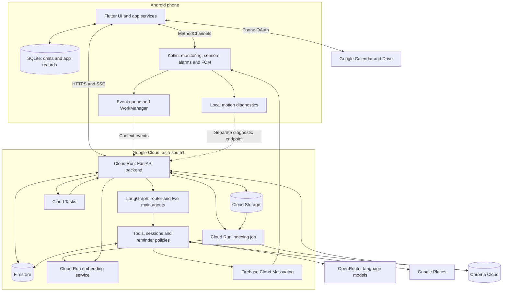
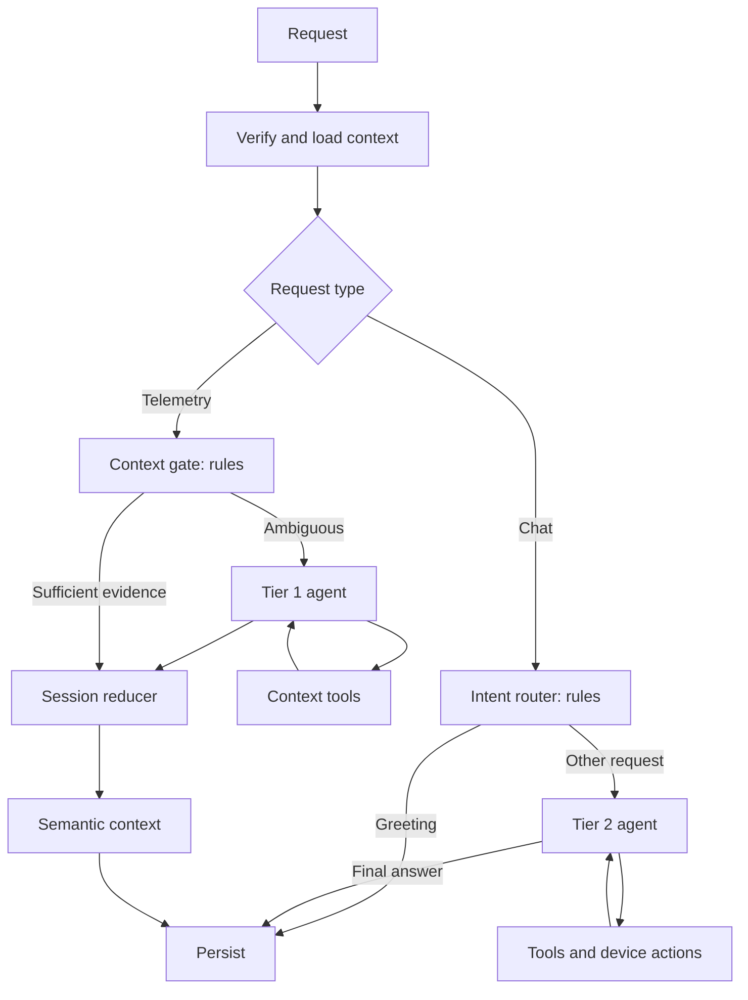

# Jarvis: full architecture and current deployment

Reviewed 13 October 2026. This report combines the current working tree with read-only cloud inspection. Existing uncommitted work was preserved. No application, account, infrastructure or user-data changes were made for this report.

Jarvis is an Android personal assistant with substantial processing on the phone, a Python backend on Cloud Run, and a separate file-retrieval pipeline. It is best described as a **mobile application plus a modular backend**, with a dedicated embedding service and indexing job. The agents are modules inside the backend, not independently deployed services.

## 1. System architecture

Editable diagram: [system.mmd](system.mmd). Agent flow: [agents.mmd](agents.mmd).

Arrows represent application-level dependencies, not every network hop. Backend SQLite is omitted from this compact view; the standalone system diagram includes it. Diagnostic motion records are stored separately and do not enter the agent/session/automation pipeline.

## 2. Frontend: Flutter plus native Android

The five main tabs are **Chat, Activity, Reminders, Notes and Settings**. Flutter builds the interface in Dart. An `IndexedStack` retains tab state; wider layouts use a navigation rail. Motion monitoring is a settings screen, not a sixth main tab. This repository does not contain a separate React/Next.js web frontend.

State is managed through service singletons, `ChangeNotifier`, `ValueNotifier`, controllers and widget state. The chat composer listens locally for edits, so each keystroke no longer rebuilds the entire chat screen. Progress has its own notifier. These are frontend responsiveness improvements; they do not eliminate model, network or cloud startup latency.

| Component | Responsibility |
|---|---|
| `ChatScreen` | Conversation display, draft input, attachments, history selection, send/stop and approval UI |
| `ApiService` / `CommandClient` | REST, SSE progress, reconnect, command identity, completion and phone-action callbacks |
| `LocalDbService` / `ChatStorageService` | Local SQLite persistence, saved chats, app records and recall queries |
| `SyncService` | Pending writes, deletions and cloud reconciliation |
| `SensorService` / native Kotlin | Activity/location observations, sensor recording and background handoff |
| `GoogleCalendarService` / `CalendarExecutor` | Google authorization, event operations, ETag checks and execution receipts |
| `GoogleDriveService` | Catalog/search, file export/read, attachment cache, relevant metadata and indexing uploads |
| `HealthService` / `UsageService` | On-demand Health Connect and foreground screen-time answers; these can bypass the cloud agent |

Kotlin is a substantial part of the product. MethodChannels connect Dart to permissions, Google account access, Android activity recognition, background location, WorkManager, notifications, alarms and device-side actions. Native workers can operate while the Flutter screen is closed, subject to Android execution restrictions and granted permissions. No WhatsApp integration was found in the inspected mobile or backend application source.

## 3. Background monitoring and the two notifications

`MonitoringService` owns ongoing monitoring, notification 1002 and the local motion monitor. It is sticky while monitoring is enabled. Android activity recognition remains the established source for production activity automation.

`TelemetryForegroundService` is the separate recording service, notification 1001, whose default wording is “Active in background.” It is not sticky and stops with recording. Its disappearance does not establish that the monitoring service stopped.

The October 12 implementation adds a local diagnostic detector: accelerometer windows, hardware steps, optional gyroscope/significant-motion signals and available GPS speed. It requests 5 Hz sampling while stationary and 25 Hz while active, with 15-second evaluation windows and bounded wake-lock use. These are requested operating parameters, not guaranteed delivery rates or transition latency.

The local detector is a **provisional rules baseline**, not a trained on-device AI model. It writes to `jarvis_telemetry_history.db` and uploads through `/motion-diagnostics`. It does not create journeys, determine activity totals, trigger reminders, call Places, or invoke the LLM. User-labelled motion intervals support later evaluation. Usable windows require sufficient fresh, continuous samples; missing evidence remains unknown.

The diagnostic SQLite store retains same-boot evidence for up to 24 hours, capped at 12,000 GPS fixes and 6,000 diagnostic rows. Boot identity and monotonic timestamps help distinguish delayed delivery from the actual observation time. Established native context events still use a SharedPreferences queue; they were not migrated into this diagnostic database.

## 4. Backend: FastAPI application and domain services

`backend/src/api/main.py` starts FastAPI and registers routers. Pydantic validates incoming requests. The main responsibilities are commands, context-event ingestion, synchronization, reminders/notes/places, activity history, recording backup, file memory/indexing, motion diagnostics and authenticated background callbacks.

LangGraph selects the reasoning path. Domain services implement deterministic work such as activity/session reduction, historical reports, reminder policies, command leases, action receipts, budgets and notifications. The backend also maintains a local SQLite database for caches, repositories and some state. That SQLite file is instance-local; it is not a shared durable cloud database.

The application uses HTTP REST and **Server-Sent Events**. SSE carries progress updates, phone-action requests and the final result. This is not a WebSocket channel or general token-by-token answer stream. The current model call normally completes before the final answer is sent.

Cloud Run hosts the Python program. Cloud Run does not itself interpret the user's request, select tools, retain the conversation or run a separate “router agent.” Those behaviors come from the application code.

## 5. Agents and routing

| Component | Model call? | Role |
|---|---|---|
| Request-type router | No | Separate user commands from context events |
| Intent router | No | Recognize simple greetings; send other commands to Tier 2 |
| Context gate | No | Decide whether telemetry needs Tier 1 reasoning |
| Tier 1 | Yes, when needed | Resolve ambiguous context using a bounded tool loop |
| Tier 2 | Yes, except deterministic shortcuts | Conversation, planning, tool choice and actions |
| Attachment-routing pass | Yes, inside Tier 2 | Narrow first-pass tool selection for newly attached files |
| Embedding service | Different model, not an agent | Convert text/media into vectors for retrieval |

There are **two main LLM agent nodes**. There are routers, but no separately deployed third router agent. Attachment routing is an additional model pass within Tier 2. Ordinary “hi” can complete without a model call. An activity recap can finish from verified tool evidence without another generation.

Live backend environment variables select `z-ai/glm-5.3-flash` for both Tier 1 and Tier 2 through OpenRouter. Other specialized model defaults exist in source, including PDF/multimodal processing; those defaults were not verified against the deployed image. The confirmed Tier 2 completion allowance is 16,384 tokens, including provider reasoning where applicable.

The source graph defaults to 50 iterations, but interactive command safeguards separately cap execution at 10 minutes, 24 model rounds and 48 tool calls, and stop repeated identical operations. These independent limits should not be confused with the model's context window.

## 6. Context and memory: current behavior

The previous eight-message explanation is obsolete for this working tree. Memory is now divided into several mechanisms:

| Context type | Selection and bounds | Limitations |
|---|---|---|
| Recent conversation | Up to 24 messages and 16,000 characters, bounded on phone and backend | Character budget, not tokenizer-accurate; not the whole conversation |
| Earlier saved answers | Phone SQLite searches up to 80 candidate questions; selects up to five answer pairs within 12,000 characters | Lexical retrieval, not semantic chat search; historical answers are not freshly verified facts |
| File metadata | Up to 12 relevant cached references; explicit attachments have priority | Metadata is not the file contents; keyword matching can miss indirect references |
| File content | File-search/read tools, vector retrieval and direct analysis when selected | Depends on index coverage, source version, network and authorization |
| Activity/location | Requested through tools and assembled from observed records | Sampled evidence, gaps and stale readings require explicit handling |
| In-flight agent state | Agent messages and tool outputs for the active request | Not a durable cross-chat memory or rolling summary |

Older-answer recall preserves source chat, message IDs and timestamp. It excludes failed replies, action-executing answers, immediately challenged answers and duplicates already in recent context. Fresh/current-time requests bypass this recall; new attachments take precedence. Deleting the saved chat removes that recall source.

There is **no rolling conversation summary in the active path**. There is also no separate verified personal-facts database created by this recall feature. A long conversation may lose continuity when it falls outside recent history and lexical retrieval misses the relevant older answer.

Your earlier gibberish incident came from a validation failure, before the model ran. Current source filters out zero-match cached file references and translates structured validation errors into readable messages. The live OpenAPI schema now accepts the AI Studio and Colab URL forms that caused that incident and includes `recalled_answers`. This confirms the deployed interface changes; it is not a fresh replay of your meeting request.

## 7. Databases and ownership

| Store | Data | Architectural role |
|---|---|---|
| Phone `jarvis_mobile.db`, schema 8 | Chats/messages, notes, reminders, places, cached activity days, pending deletions, Flutter context outbox | Responsive offline UI and saved-chat recall |
| Phone `jarvis_telemetry_history.db`, schema 1 | Bounded GPS fixes and diagnostic windows/labels | Separate evidence and diagnostic upload buffer |
| Android SharedPreferences | Established native context queue and small settings/state | Native background handoff, not relational storage |
| Phone files | Raw recording CSV and summary JSON | Explicit recordings, distinct from inferred activities |
| Backend SQLite, 15 declared tables | Tasks, notes, places, preferences, sessions, events, chats, automations, reminders, trigger state, notifications, audit entries | Local repositories/cache; some features still depend on instance-local state |
| Firestore | Synced app records, request state/leases, activity context/sessions, diagnostics, notification outboxes, device/action state, AI spending ledger, file metadata | Durable cloud application state |
| Cloud Storage | Recording backups, staged indexing files and build sources | Binary/object storage |
| Chroma Cloud | File chunks, vectors and retrieval metadata | Semantic file search; not the main application database |
| Google Drive / Calendar | Original user files and calendar events | External systems of record accessed with Google authorization |

Firestore has mixed structure: top-level `reminders`, `notes`, `places`, `chat_sessions` and `chat_messages`; user-scoped collections beneath `users/{uid}`; and file metadata beneath `file_memories/{uid}`. This is not a fully uniform multi-tenant schema.

Mobile SQLite and Firestore are synchronized. “Saved locally,” “synced to cloud,” “action completed in Calendar,” and “notification delivered” are separate states and should never be treated as equivalent guarantees.

## 8. Live Google Cloud inventory

Project: `jarvis-agent-61947`. Both listed Cloud Run services are in `asia-south1` (Mumbai). Read-only inventory on October 13 found:

| Runtime | Active revision / sizing | Purpose |
|---|---|---|
| `jarvis-backend` service | `jarvis-backend-00123-bef`, 100% traffic; 1 vCPU, 512 MiB; concurrency 80; request timeout 900 seconds; max scale 20 | API, agents, tools and task callbacks |
| `jarvis-embedding` service | `jarvis-embedding-00003-6cc`, 100% traffic; 4 vCPU, 8 GiB; concurrency 2; timeout 300 seconds; max scale 2 | CPU embedding inference |
| `jarvis-drive-indexer` job | 2 vCPU, 4 GiB; one task, parallelism one; one retry; configured task timeout 604,800 seconds | On-demand batch indexing; timeout is a ceiling, not observed duration |
| Cloud Tasks `jarvis-background` | RUNNING; maximum eight concurrent dispatches and two dispatches/second | Durable commands, reminder delivery and background work |
| Firestore `(default)` | Native mode, `asia-south1` | Durable document database |

No explicit minimum-instance setting was present in the inspected service/revision annotations. A service deployment is not evidence of a continuously warm instance. Cloud Tasks provides durable dispatch rather than relying solely on an in-process timer.

The backend permits public Cloud Run invocation; the embedding service's inspected IAM policy has no public invoker grant. Backend-to-embedding requests use Google identity tokens. Cloud Tasks callbacks validate OIDC audience and service-account identity.

Application buckets are `jarvis-agent-61947-recordings` and `jarvis-drive-index-staging-jarvis-agent-61947`, both in `ASIA-SOUTH1`. There are also build/source buckets, including one in `US` and an older source bucket in `EUROPE-WEST1`; those do not establish additional running application services. The indexer mounts the staging bucket read-only.

Cloud Scheduler inventory reported its API disabled. No Scheduler configuration was enabled during this review. Scheduled behavior in the inspected architecture uses Cloud Tasks plus Android alarms/WorkManager and application mechanisms.

The production health endpoint returned `healthy` and an INR 50 daily AI allowance. Its `mode: local` and `jarvis-local-api` labels are application strings; they do not mean the deployed backend is running on your computer.

## 9. What happens when you send a message

1. Flutter shows the user message immediately and saves the conversation locally.
2. It assembles bounded recent history, relevant past answers, file metadata and device capability information. Health/screen-time questions may be answered locally.
3. `/commands/stream` validates the payload and accepts the stable request ID. Firestore holds durable command state, ownership and the saved response.
4. Cloud Tasks dispatches an authenticated callback to the backend. The phone can disconnect while server-side work continues.
5. LangGraph routes a greeting directly or invokes Tier 2. Tools retrieve only the personal context needed for the task.
6. Phone-dependent operations such as Calendar and authorized Drive access are handed back as device actions. The phone performs the operation and returns its result. These steps still require the phone and appropriate permissions; cloud execution does not remove that dependency.
7. The backend persists the result. SSE returns progress and completion; reconnect uses the same request ID, and FCM can notify the phone of completion or required input.

Cancellation is cooperative. It does not undo already completed actions. Stable request IDs and receipts reduce duplicate execution, but delivery and external side effects remain separate concerns.

## 10. Activity and reminders

Google activity observations and native location evidence enter the established queue. WorkManager uploads them to `/context-events`. The graph gates optional Tier 1 reasoning, reduces sessions and updates semantic context; deterministic automation checks eligible, fresh evidence against reminder policies. Persisted notification outboxes feed FCM.

Time reminders can be scheduled through Cloud Tasks. Downloaded alarms and in-app ringing use Android scheduling and permissions. “Call me” reminder mode is an in-app ringing screen, not an actual telephone call. A saved reminder alone does not prove the phone has armed or displayed it.

The separate `/motion-diagnostics` path records provisional local observations and labels without triggering this automation pipeline. This boundary is important: experimental sensor classification should not silently become a production reminder trigger.

## 11. Drive search and indexing

The phone authorizes Drive access. Selected files can be exported/downloaded and staged in Cloud Storage. A Cloud Run indexing job reads staged data, extracts content, chunks it, calls the private embedding service and writes vectors/chunks to Chroma Cloud. File metadata/index progress are stored separately.

The embedding source pins `google/embeddinggemma-2` at revision `914f7f89142e33e77833254d9c9b90c3cef7303b`, producing normalized 768-dimensional vectors. Retrieval uses collection `jarvis-drive-eg2-768-v1` and filters by ownership/capability, account and source/version metadata. These implementation settings were read from code; the embedding model was not freshly invoked during this review.

A question embeds the search query, retrieves matching chunks and supplies evidence to the answer path. Direct file analysis is another path, including specialized media/PDF processing. Not every file question requires reindexing, and not every Drive file is necessarily already indexed. Query embedding has a shorter timeout than background indexing; cold embedding startup can affect responsiveness.

## 12. Deployment and observability

Flutter produces an APK installed on Android. Python is packaged into Docker images, built with Cloud Build, stored in Artifact Registry and deployed to Cloud Run revisions. Cloud Run jobs execute batch work from a container image. Logs, health/schema checks, application audit entries and request progress support diagnosis.

Recent release notes document selective backend overlays onto existing images. The October 12 motion release flattened an image that had reached its layer-depth limit and excluded unrelated working-tree changes. Therefore **the current working tree is not proven byte-for-byte identical to production**. Live revisions, configuration, health and OpenAPI fields above are confirmed independently; internal behavior descriptions are based on current source and clearly identified release notes.

The connected phone reports app version `1.0.0`, last updated October 12 at 15:42:26, with no `DEBUGGABLE` package flag. At inspection, `MonitoringService` was running in the foreground with notification 1002. This snapshot does not establish uninterrupted background monitoring or measured battery performance since installation. Earlier test counts in feature notes are historical validation, not tests rerun for this report.

## 13. Strengths and important limits

Strengths include offline local UI data, durable command identity/recovery, a separate heavy embedding runtime, phone-owned Google authorization, deterministic activity evidence reporting, and keeping experimental motion diagnostics separate from production actions.

The main architectural issues to prioritize are:

1. **Identity and access:** the backend currently returns a fixed `jarvis_local_user` identity. Public invocation plus this fixed identity is a personal-project setup, not per-user authorization suitable for public multi-user use. Device capability checks and task OIDC protect specific paths but do not replace end-user authentication.
2. **Durability:** instance-local SQLite must not become the sole source for durable cross-instance records. The cloud persistence paths need an explicit ownership contract per entity.
3. **Synchronization:** current sync-push paths append acknowledged IDs after Firestore helpers that can log and swallow write failures. Some read helpers turn errors into empty lists. This can confuse “cloud unavailable” with “successfully empty”; reconciliation deserves a focused reliability review.
4. **Memory quality:** lexical recall is useful but does not provide conversation summarization, semantic chat retrieval, complete correction history or newly verified facts. Character budgets approximate size rather than guarantee a model token budget.
5. **Background coverage:** Android restrictions, permissions, sensor batching and phone placement can create gaps. Neither a sticky service nor cloud uptime establishes continuous observation. The local motion baseline still needs labelled accuracy and unplugged battery evaluation.
6. **Latency and capacity:** cloud startup, provider latency, file processing and device callbacks remain. A backend configured for 80 concurrent requests and 512 MiB should be load-tested with representative work; configuration alone is not a throughput guarantee.
7. **Reproducibility:** move toward releases tied to reviewed source snapshots with recorded image/APK hashes, rather than accumulated selective overlays.

INR 50 is the application's daily AI spending allowance, not a total bill cap. Cloud Run, Tasks, Firestore, Storage, Places, Chroma and network usage have separate cost boundaries. No current bill or cost forecast was calculated here.

## 14. Source reading guide

| Question | Source |
|---|---|
| App bootstrap / navigation | `mobile/lib/main.dart`, `mobile/lib/ui/screens/main_navigation_screen.dart` |
| Chat typing / transport | `mobile/lib/ui/screens/chat_screen.dart`, `mobile/lib/services/api_service.dart`, `mobile/lib/services/command_client.dart` |
| Current conversation memory | `mobile/lib/services/conversation_memory.dart`, `mobile/lib/services/local_db_service.dart`, `backend/src/backend/conversation_memory.py` |
| Native monitoring | `MonitoringService.kt`, `LocalMotionMonitor.kt`, `ContextEventQueue.kt`, `TelemetryHistory.kt` under the Android Kotlin package |
| API / identity | `backend/src/api/main.py`, `backend/src/api/auth.py`, `backend/src/models/schemas.py` |
| Actual agent graph | `backend/src/graph/builder.py`, `nodes/intent_router.py`, `nodes/context_gate.py`, `nodes/tier1_agent.py`, `nodes/tier2_agent.py` |
| Durable requests / tasks | `backend/src/services/command_run_store.py`, `backend/src/services/background_tasks.py`, `backend/src/api/routers/commands.py` |
| Activity / reminders | `backend/src/backend/activity_sessions.py`, `activity_report.py`, `context_automation.py` |
| Storage / sync | `backend/src/services/firestore_service.py`, `backend/src/services/database/schema.py`, `backend/src/api/routers/sync.py` |
| File retrieval | `backend/src/services/drive_index.py`, `backend/src/cloud/file_memory_tools.py`, `embedding/app.py` |
| Recent changes | `docs/chat-memory-and-budget-2026-10-12.md`, `docs/hybrid-motion-2026-10-12.md` |

The October 11 analysis/video remains a useful historical walkthrough, but its eight-message context limit, INR 20 allowance and pre-diagnostic motion description are superseded by this report.
