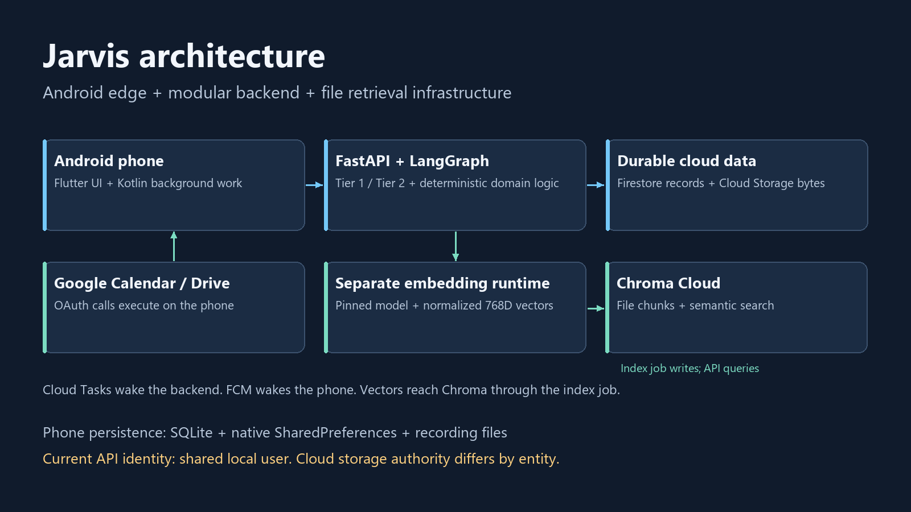
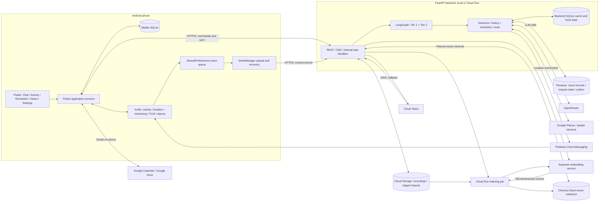
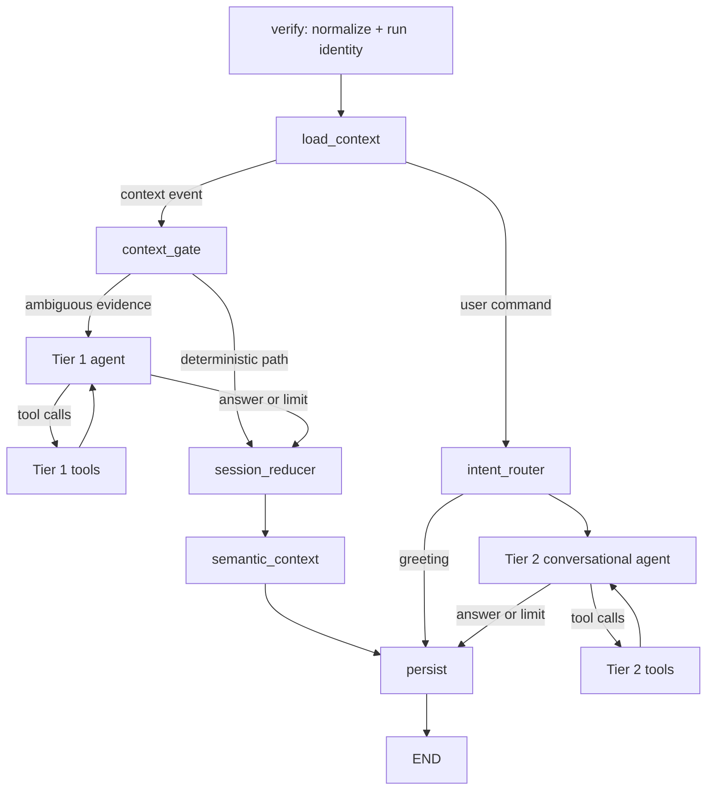
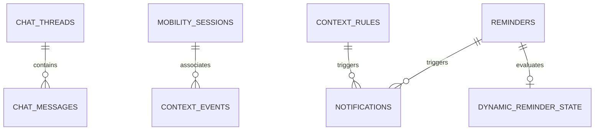
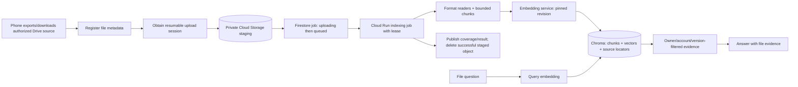

# Jarvis: architecture and project analysis

**Code review date: 11 October 2026 · Scope: the current local checkout, including existing uncommitted changes.**

Jarvis is a personal Android assistant that combines conversation with observations from the phone. It can remember notes, manage reminders, reconstruct sampled activity history, work with Google Calendar, and retrieve information from Google Drive files. The frontend is Flutter with a substantial native Android implementation in Kotlin. The backend is a Python FastAPI application containing a LangGraph workflow and deterministic domain services. A separate Python service generates embeddings for Drive retrieval.

The best architectural description is **an Android edge application plus a modular backend, with a separate embedding service and an indexing job**. LangGraph's Tier 1 and Tier 2 are reasoning branches inside that backend; they are not separately deployed backend services.

This report describes implemented behavior. It does not establish that the currently deployed cloud revision matches this checkout, that every integration is configured, or that real-device behavior meets battery and delivery targets. No production data, credentials, Google accounts, or cloud configuration were changed for this analysis.

## 1. System map





Arrows show application-level flows rather than every library call. The source Google files remain in Drive; indexing also creates staged copies and stores derived chunks/vectors. Cloud Tasks and Cloud Run indexing are distinct execution mechanisms.

## 2. Repository and technology map

| Area | Technology and responsibility | Start reading here |
|---|---|---|
| `mobile/lib` | Dart / Flutter, Material UI, services, models and local state | `main.dart`, `ui/screens/main_navigation_screen.dart` |
| `mobile/android/.../kotlin` | Android background execution, permissions, Google authorization, notifications and activity evidence | `MainActivity.kt`, `ContextEventQueue.kt`, `ContextUploadWorker.kt` |
| `backend/src/api` | FastAPI routers, Pydantic requests, middleware, identity dependency, SSE | `main.py`, `routers/commands.py`, `auth.py` |
| `backend/src/graph` | LangGraph routing and bounded agent/tool loops | `builder.py`, `state.py`, `nodes/` |
| `backend/src/backend` | Deterministic sessions, activity reconstruction, reminders, command execution and actions | `session_manager.py`, `activity_sessions.py`, `context_automation.py` |
| `backend/src/cloud` | LangChain tool definitions and model-facing reasoning | `tier1_agent_tools.py`, `tier2_agent_tools.py`, `calendar_tools.py`, `file_memory_tools.py` |
| `backend/src/services` | SQLite, Firestore, FCM, Cloud Tasks, Places, file readers and Drive indexing | `database/`, `firestore_service.py`, `drive_index.py` |
| `embedding` | FastAPI + SentenceTransformers / PyTorch on CPU; text and media embeddings | `app.py`, Dockerfiles |
| `backend/scripts` | Deployment, local bulk indexing and maintenance utilities | Read before running; several scripts delete data |
| `notebooks` | Telemetry analysis and investigation | `telemetry_analysis_and_reasoning.ipynb` |
| `docs` | Feature notes and diagnostic investigations | Calendar, file memory, budgets and session notes |

Python declares version 3.12 or newer. The backend uses `uv`; the phone uses Flutter packages and Android Gradle. Dependencies are declared in `backend/pyproject.toml`, `embedding/requirements.txt`, and `mobile/pubspec.yaml`. These declarations describe the repository, not verified current upstream release versions.

## 3. Frontend: what actually runs on the phone

### UI and state

`main.dart` renders immediately, then initializes sensors, Google connections, chat notifications, usage reporting and sync asynchronously. The live navigation contains five tabs: **Chat, Activity, Reminders, Notes, Settings**. An `IndexedStack` retains their widget state. A wider layout switches to a navigation rail. Dashboard, agent and session screen files also exist, but their existence does not make them top-level navigation destinations.

State is largely service-owned: singleton services, `ChangeNotifier`, `ValueNotifier`, timers, widget state and method channels. There is no declared Redux, Riverpod or Bloc layer. `ApiService` covers transport, command dispatch, notification polling, device actions and CRUD. This makes the app easy to follow initially but gives it a broad responsibility surface.

| Service | Role |
|---|---|
| `ApiService` + `CommandClient` | HTTP/SSE, command progress and reconnect, request status, cancellation, device-action result callbacks |
| `LocalDbService` | `jarvis_mobile.db`, schema version 8, notes, reminders, places, chat, activity-day cache, pending deletions and Flutter telemetry outbox |
| `SyncService` | Push pending records, pull remote records, reconcile local state; visible-app sync every 30 seconds |
| `SensorService` + `FeatureExtractor` | IMU recording, compact feature computation, live samples, location access and native monitoring bridge |
| `SessionStorageService` | Raw recording CSV and summary JSON files; distinct from derived backend activity sessions |
| `RecordingBackupService` | Upload/restore recording files through the session-library API |
| `GoogleCalendarService` + `CalendarExecutor` | Authorized phone-side calendar calls, proposal approval, ETag concurrency handling and write receipts |
| `GoogleDriveService` | Drive catalog/search/download/export, file metadata, retrieval and indexing uploads |
| `HealthService` | On-demand Health Connect steps/sleep reads; some questions can be answered locally |
| `UsageService` | Android app-usage reporting |

The phone has **two telemetry handoffs**. Flutter events use a SQLite `context_outbox`. Native background events use a JSON array committed to Android **SharedPreferences**, then WorkManager uploads them. The README's description of `ContextEventQueue` as SQLite is inaccurate for this checkout.

### Native Android is part of the frontend architecture

Kotlin receivers and services handle Play Services activity recognition, passive/adaptive location, phone/radio context, monitoring restart, FCM messages, bounded context requests and reminder alarms. WorkManager retries uploads and runs a periodic recovery job. This allows events and notifications to be handled without an open Flutter screen.

The manifest requests location, background location, activity recognition, notifications, usage access, Health Connect, Bluetooth and alarm-related permissions. Declared permissions alone do not establish that a user has granted them. Android scheduling, battery policy and available observations affect coverage. Activity history is a sampled timeline, not proof of a continuous GPS trace or uninterrupted physical activity.

## 4. Backend: gateway, workflow and domain logic

FastAPI registers context events, commands, automation/CRUD, sync, session library, file memories and Drive-index routers. Middleware supplies request correlation IDs, size checks and process-local request limiting. A cached dependency compiles the workflow once per process. Blocking graph and cloud work is moved to worker threads in important async routes.

### The actual graph



**Tier 1** resolves ambiguous physical evidence, especially feature-bearing telemetry. Ordinary sparse activity events without an IMU feature summary can bypass the model and use the deterministic reducer. **Tier 2** selects tools for user commands: notes, tasks, reminders, places, context recall, satellite inspection, Calendar and file operations. Both tool loops feed observations back to their agent.

User-command context loading now returns a minimal packet and marks context as **on demand**. A file question therefore does not automatically fetch GPS, Places and mobility history. Context telemetry loads relevant local data and can hydrate session/reminder/place state from Firestore.

The `verify` node normalizes input and creates run metadata. It does **not** validate an end-user login token. Identity is supplied by the API dependency described below.

### Deterministic logic and derived history

`SessionManager` handles journey state. The actual `SessionStatus` enum is **CREATED, ACTIVE, PAUSED, RESUMED, COMPLETED, EXPIRED**. Parking, dwell and shop context are separate semantic concepts; the README's IDLE/MOVING/DWELL/PARKING/SHOP_VISIT list is not the persisted session-status enum.

`activity_sessions.py` and `activity_report.py` reconstruct event-time activity history with evidence and coverage gaps. This is different from both the journey state machine and explicit phone sensor recordings. A complete architecture analysis must keep these three kinds of “session” separate.

Reminder automation runs after successful event persistence and uses deterministic rules. Immediate context alerts require fresh evidence: the ingestion route checks a five-minute freshness window. Delayed uploads still contribute to history. Activity-delay reminders have durable timer state and authenticated Cloud Task callbacks, so a subsequent phone event is not required just to wake the timer.

### Commands outlive the connection

`CommandRunStore` uses Firestore request fingerprints, leases and a per-user active control document. Reusing a request ID with a different payload fails; an existing request can be reconnected to. Firestore is required to safely start commands, even when the Python API runs locally. Cloud Tasks continue execution independently of the phone. The Cloud Run command path requires task configuration; a local in-process task path exists outside Cloud Run when task delivery is not configured.

Progress uses **server-sent events**, with status polling/reconnect support. This is not a WebSocket architecture. Commands have cancellation checks, time/round/tool limits, and protection against repeating an uncertain worker execution. The graph iteration setting and command execution limits are different controls: settings default to 50 agent iterations, while command execution defines 600 seconds, 24 model rounds and 48 tool attempts.

Independent read tools can run concurrently. Writes and read-after-write dependencies remain ordered. Certain paired device file reads are batched in groups of two.

## 5. Database and storage architecture

There is no PostgreSQL/MySQL server in this implementation. There are relational caches/local stores, a cloud document database, object storage and a vector index.

| Store | What it holds | Durability / ownership meaning |
|---|---|---|
| Phone SQLite | Notes, reminders, places, chats, cached activity days, pending deletes, Flutter event outbox | Device-local offline state; uploaded through API |
| Android SharedPreferences | Native event JSON queue, monitoring/activity state, other native preferences/receipts | Durable across ordinary process death; not a SQL queue |
| Phone filesystem | IMU CSV and JSON recording summaries | Raw recordings, with explicit cloud backup path |
| Backend SQLite | Tasks, preferences, local CRUD, journey sessions, events, chats, rules, notifications, audit | Persistent in a normal local checkout; container-local fallback/cache in Cloud Run |
| Firestore | Shared cloud records, context memory, command requests, outbox, budgets and index-job metadata | Main cross-instance durable store for those implemented paths |
| Cloud Storage | Recording backups and staged Drive import sources | Binary objects; metadata stays in Firestore |
| Chroma Cloud | Derived file chunks, metadata, normalized 768-dimensional vectors | Semantic retrieval index, filtered by capability owner/account/file/version |
| Google Drive / Calendar | Source files / calendar events | External account data accessed with phone authorization |

### Backend SQLite schema

The schema declares 15 tables: `tasks`, `notes`, `places`, `preferences`, `mobility_sessions`, `context_events`, `chat_threads`, `chat_messages`, `automations`, `reminders`, `dynamic_reminder_state`, `context_rules`, `context_trigger_state`, `notifications`, `audit_entries`.

Most records use a text ID, `uid` and timestamps. Complex fields are JSON stored as TEXT. Indexes cover user, session status, reminder due time, notification status and audit lookup. WAL mode, NORMAL synchronous mode, connection timeouts and short-lived committed connections support local concurrency. Migrations use guarded `ALTER TABLE` statements rather than a versioned migration framework.

Logical relationships are:



These are logical relationships. Only `chat_messages.thread_id` declares a SQL foreign key in this schema, and the connection code does not enable `PRAGMA foreign_keys`. Do not assume the diagram's relations are all enforced by the database.

### Actual Firestore layout

```text
reminders/{id}                  # uid field; top-level
notes/{id}                      # uid field; top-level
places/{id}                     # uid field; top-level
chat_sessions/{id}              # uid field; top-level
chat_messages/{id}              # uid + thread_id fields; top-level
users/{uid}/
  mobility_sessions/{id}
  semantic_contexts/{id}
  context_memory/{event-id-derived-key}
  activity_sessions/{id}
  activity_routines/current
  notifications/{id}
  command_runs/{request-id-hash}
  command_control/active
  devices/{token-hash}
  context_requests/{id}
  ai_usage/{IST-date}
session_libraries/{uid}/preferences/{id-hash}
session_libraries/{uid}/recordings/{id-hash}
file_memories/{capability-owner-hash}/files/{file-id-hash}
file_memories/{capability-owner-hash}/analyses/{action-id-hash}
drive_index_jobs/{job-id}
drive_index_control/worker
```

This is a map of the inspected paths, not a complete live database export. Some top-level reads stream the collection and filter `uid` in Python. That approach becomes increasingly expensive as records/users grow.

**Durability gap:** the inspected task tools write to backend SQLite. Tasks are absent from the mobile sync payload and the inspected Firestore CRUD implementation. Preferences, legacy automations and audit entries also require a path-by-path durability review. A SQLite table name is not evidence of cloud persistence. Treat cloud-hosted tasks as potentially instance-local until that gap is resolved.

## 6. Five main end-to-end flows

### A. “Remind me when I reach the garage”

1. Flutter sends text, stable request ID, thread and available device capabilities.
2. Firestore claims the command and SSE exposes progress.
3. Tier 2 chooses reminder/place tools, validates fields and creates the reminder.
4. Ordinary requested reminder writes are currently allowlisted to run without a separate approval dialog.
5. A later native phone event is queued before upload; FastAPI normalizes and persists it.
6. Deterministic automation checks fresh matching context and commits reminder completion plus notification in one Firestore transaction.
7. FCM, native recovery polling or visible-app polling delivers the outbox item; the phone acknowledges it.

Delivery is designed around retries and deduplication, not a guarantee that Android always displays an alert at an exact second.

### B. “Where was I yesterday?”

Tier 2 requests historical context only when needed. The history layer queries durable context memory, sorts/rebuilds activity from observation time, and reports coverage gaps. Late uploads can revise the reconstructed history. Nearby businesses remain candidates unless stronger evidence confirms the context; an inferred shop visit does not prove a purchase.

### C. Google Calendar write

The backend proposes an operation. SSE/status exposes a device action with an action ID and expiration. Flutter shows the actual calendar change, asks for approval, then calls Google Calendar using the phone's authorization. The result returns to the backend. ETags detect changed events; receipts stop uncertain writes from being repeated after a lost response. Google access tokens stay on the phone, while relevant event content can enter backend/LLM/chat history. The app must remain available to respond to the device proposal.

### D. Drive indexing and retrieval



The separate embedding service loads a pinned `google/embeddinggemma-2` revision, runs on CPU and produces normalized vectors of dimension 768. The collection is `jarvis-drive-eg2-768-v1`, with cosine distance. The backend verifies revision/dimensions before accepting embeddings. File readers cover documents, spreadsheets, presentations, archives and media, with metadata-only coverage for some unsupported content. Failed jobs preserve their staged source for retry; successful imports delete their staged object.

There is also direct foreground indexing and a local bulk-index script. The embedding README recommends local extraction and inference for large imports, while ordinary phone import still uses the cloud queue. These are available alternate execution paths, not an automatic switch based on file count.

Native PDF/image/video analysis is a different path: limited source bytes pass transiently through the backend to a multimodal model, with an analysis claim and shared AI allowance. “Original stays in Drive” does not mean no derived content or staged copy ever exists outside Drive.

### E. Offline note and chat synchronization

Local rows marked `pending` are pushed through `/sync/push`. Returned IDs are marked synced. `/sync/pull` retrieves the cloud snapshot and reconciles it into mobile SQLite. Pending reminders and notes are protected against replacement on pull; chat deletions have a durable pending-delete queue. Remote omission can delete previously synced local rows. This is snapshot reconciliation rather than a cursor-based change feed.

## 7. API map and trust boundaries

| Family | Important routes | Identity / behavior |
|---|---|---|
| Health | `/`, `/health` | SQLite probe; not comprehensive dependency readiness |
| Telemetry | `POST /context-events` | Shared local-user dependency; returns 202 after invoking workflow |
| Chat | `/commands/stream`, `/commands`, `/commands/requests/{id}`, cancellation | Shared UID; device-session hash checked where a request is bound to it |
| Device actions | `/commands/requests/{id}/calendar-result` | Bound device session, action identity and expiry |
| CRUD/history | `/notes`, `/reminders`, `/context-rules`, `/context-memory`, `/activity-history` | Shared local-user dependency |
| Sync | `/sync/push`, `/sync/pull` | Shared local-user dependency; full snapshots |
| Delivery | `/devices/push-token`, `/notifications`, acknowledge | Shared local-user dependency |
| Session library | `/session-library/...` | Shared local-user dependency; bounded streamed recording uploads |
| File memory | `/file-memories/...` | 64-hex-character bearer capability; owner hash namespaces metadata |
| Indexing | `/drive-index/...` | File-memory capability; Chroma filters and version checks |
| Internal workers | `/internal/background/...` | Validated OIDC audience and configured task service-account identity |

**Critical distinction:** `get_current_user()` always returns `jarvis_local_user`. The mobile `X-User-ID` header does not turn into authenticated per-user identity. File capabilities, bound calendar sessions and task OIDC are meaningful safeguards on their own paths, but they do not supply end-user authentication for all routes. This checkout is a personal deployment design, not an isolated multi-user service.

Calendar writes require device approval. The current `ROUTINE_WRITE_TOOLS` allowlist exempts ordinary requested personal writes such as note/reminder creation. Deletion, consolidation and unknown writes still use the device approval path when configured. The calendar document's statement that all other saved-data writes require approval is stale for the inspected code.

## 8. Deployment, observability and cost

The backend Docker image runs Uvicorn on the configured port and installs file-reading dependencies including FFmpeg, libarchive and LibreOffice. Runtime Dockerfiles reuse a supplied base image and copy changed application source. Cloud Build configuration builds/publishes those runtime images. Deployment scripts configure backend services, the separate embedding runtime and the indexing job; the repository describes region `asia-south1`. Live scaling, IAM, billing and deployed versions were not inspected.

The backend combines structured logs, correlation IDs, node/tool timing and SQLite audit entries. LangSmith tracing is configurable and defaults off in settings. The command route logs the user's full text, so log retention/access belongs in the data-governance design. `/health` currently tests SQLite and exposes configured AI-budget information; a healthy result does not establish Firestore, Chroma, LLM or embedding availability. Firestore's `is_available` flag means a client was constructed, not that a live read just succeeded.

AI calls use a reservation/reconciliation ledger. Cloud Run uses transactional Firestore budget records and fails closed if durable allowance storage is unavailable; local runs use memory. The policy encodes a ₹20 daily AI allowance and resets by IST date. Its USD conversion and model rates are fixed code configuration, not current price quotations. That budget is separate from Cloud Run compute, Cloud Build, Storage, Firestore, Chroma, Places and network costs. Bulk embedding/indexing can dominate compute, as the repository's previous investigation reports.

## 9. Assessment: strengths and issues to investigate

### What is already well designed

- Native event persistence before upload and stable event IDs preserve observations through ordinary disconnects.
- Cloud request identity, execution leases, device action receipts and outbox transactions explicitly handle duplicate delivery and uncertain writes.
- Telemetry interpretation and reminder triggers are mostly deterministic; models are used selectively.
- Conversation context is loaded on demand, avoiding unrelated enrichment for file questions.
- Embedding version/dimension validation and owner/account/source-version filtering reduce index mixing and stale retrieval.
- Activity history retains uncertainty and sampled coverage rather than manufacturing complete movement evidence.
- Tests cover many difficult boundaries: approvals, late events, budgets, file readers, retries, background delivery and UI layout.

### Prioritized findings

| Priority | Finding and code evidence | Practical consequence | Suggested next action |
|---|---|---|---|
| P0 for multiple users | `api/auth.py` fixed UID; CRUD/sync/delivery depend on it | Callers share data namespace, budgets and command control; changing an HTTP header is not authentication | Verify a real user token, derive UID from it, scope every record/query/action and test cross-user denial |
| P1 | Task tools use SQLite; sync schema has no tasks | A task created on one cloud instance may not be available on another or survive recycling | Decide authoritative storage for each entity; add durable task persistence and reconciliation |
| P1 | Sync acknowledges IDs even when Firestore is unavailable or a save returns false | Phone may mark an item synced before cloud durability exists; chats have no equivalent SQLite write in that route | Acknowledge only committed durable writes; return per-item errors and keep failed rows pending |
| P1 | Firestore readers catch errors and return `[]`; mobile reconciles omissions as deletion | A read failure can resemble a legitimately empty cloud collection | Make incomplete snapshots explicit; refuse destructive reconciliation on incomplete/error responses |
| P1 | Direct `/drive-index/files/{file_id}` handler accumulates source bytes without a route-level total cap; middleware relies on Content-Length | Requests without trustworthy size metadata can consume instance memory | Enforce streaming byte limits; favor staged uploads; bound concurrency and file expansion |
| P1 | Cloud session hydration and persistence are separate operations; no whole-event cloud session transaction in the inspected path | Concurrent context requests can race despite freshness/idempotency protections | Test cross-instance event races and add serialization/version checks where required |
| P2 | Full sync snapshots and some Firestore full-collection scans | Growing read costs, payloads and reconciliation work | Use scoped server queries, indexes, pagination and explicit change cursors/tombstones |
| P2 | Native queue rewrites a whole SharedPreferences JSON array | Large offline backlogs increase CPU/I/O and memory overhead | Use a bounded Room/SQLite queue with item-level retries and observable depth |
| P2 | Flutter configurable URL, native upload worker fixed URL | Foreground and background traffic may go to different environments | Supply one environment configuration to both layers |
| P2 | Local-rate trackers, permissive CORS, health mainly SQLite | Per-instance limits and dependency failures are harder to reason about at scale | Use trusted identity and shared limits, tighten web origins if applicable, separate liveness/readiness |
| P2 | Large service/tool files; stale documentation and misleading “local” labels | More difficult ownership, review and troubleshooting | Separate transport/device actions/domain tools; keep diagrams and contracts beside code |

These are architecture findings from code inspection, not a claim that each risk has already caused a production incident. The sync acknowledgment and empty-snapshot behavior are directly visible; real cloud outage/race effects require controlled integration tests.

## 10. Suggested analysis order

1. Understand the five user-facing tabs and which actions can execute locally.
2. Follow one chat request from `ApiService` to command storage, graph tools and response.
3. Follow one background event from the Kotlin queue through persistence to the reminder outbox.
4. Build an entity-by-entity authority matrix: who owns it, where it is durable, and how conflicts/deletes work.
5. Review account identity and each device/cloud capability boundary.
6. Examine Drive indexing separately from conversational AI and direct multimodal analysis.
7. Test outage, retry, concurrency and permission-denial behavior before using happy-path latency as a success metric.

The first design decisions should be **single-user versus multi-user**, **authoritative storage for every entity**, and **the guarantee behind a sync acknowledgement**. Splitting the backend into more services is lower priority than making those contracts explicit.

## 11. Source evidence and verification

The companion `source-map.json` records source paths, file sizes/line counts, declared routes and test-file inventory. It is generated from source text and AST without querying stored personal data. `validation.txt` contains the targeted test outcome. Existing application code was not edited as part of this report.

**Completed validation: 49 tests passed in 20.43 seconds.** The selected files were `test_api_schema.py`, `test_durable_budget.py`, `test_session_library.py`, `test_motion_evidence.py`, and `test_routine_write_approval.py`. They ran with an isolated SQLite path and a workspace-local pytest temporary directory. This is a targeted backend check, not the full backend/Flutter/Android suite, and does not test live cloud integrations. An earlier broader invocation was interrupted without a complete result; an initial rerun encountered pytest temporary-directory setup errors, which were resolved by using the workspace-local directory. No application fix was needed for that environment issue.

The final MP4 was decoded from beginning to end with FFmpeg, with exit code 0. It contains H.264 video at 1600 × 900 and AAC narration, and is approximately 7 minutes 59 seconds long. All 11 source slides were visually inspected. `media-validation.txt` records the media checks. Caption cues use approximate sentence timing within measured narration scenes.

Key anchors (repository-relative paths):

| Claim | Evidence |
|---|---|
| UI startup / current navigation | `mobile/lib/main.dart`; `mobile/lib/ui/screens/main_navigation_screen.dart` |
| Phone state, telemetry and sync | `mobile/lib/services/api_service.dart`; `local_db_service.dart`; `sync_service.dart` |
| Native queue is SharedPreferences | `mobile/android/app/src/main/kotlin/com/jarvis/jarvis_collector/ContextEventQueue.kt`, `prefs()` and `add()` |
| Background upload/recovery | `ContextUploadWorker.kt`, `doWork()` and `BASE_URL` |
| Fixed API identity | `backend/src/api/auth.py`, `get_current_user()` |
| Graph routing and loops | `backend/src/graph/builder.py`, `build_workflow()` |
| On-demand chat context | `backend/src/graph/nodes/load_context.py`, early `USER_COMMAND` return |
| Session enum / domain | `backend/src/models/enums.py`, `SessionStatus`; `backend/src/backend/session_manager.py` |
| Cloud + local persistence | `backend/src/graph/nodes/persist.py`; `backend/src/services/firestore_service.py` |
| Command identity/actions | `backend/src/services/command_run_store.py`; `backend/src/api/routers/commands.py` |
| Routine approval exemptions | `backend/src/graph/nodes/tier2_tools_node.py`, `ROUTINE_WRITE_TOOLS` |
| Local-only inspected task path | `backend/src/cloud/tier2_agent_tools.py`, `create_task()` / `list_tasks()` |
| Sync acknowledgement behavior | `backend/src/api/routers/sync.py`, `push_offline_records()` |
| Empty snapshot deletion | `mobile/lib/services/local_db_service.dart`, `reconcileRemoteRecords()` |
| SQL schema/connections | `backend/src/services/database/schema.py`, `connection.py`, `service.py` |
| File capabilities / transient analysis | `backend/src/api/routers/file_memories.py`, `owner()` / `analyze()` |
| Index staging, leases and cleanup | `backend/src/services/drive_index_queue.py`, `begin()` / `kick()` / `drain()` |
| Vector contract / retrieval | `backend/src/services/drive_index.py`; `embedding/app.py` |
| Background delivery identity | `backend/src/services/background_tasks.py`, `verify_task_identity()` |
| Recording backup | `backend/src/api/routers/session_library.py`; `mobile/lib/services/recording_backup_service.dart` |
| AI allowance and observability | `backend/src/api/rate_limiter.py`, `spend_policy.py`, `middleware.py`, `main.py` |

## 12. Video companion

`jarvis-architecture-explained.mp4` presents this architecture in English with locally synthesized narration and readable diagram slides. `video-transcript.md` provides the spoken text; `captions.vtt` provides timed captions. The video explains inspected code rather than showing a live phone or cloud deployment. `watch.html` provides a local player with chapter links.
