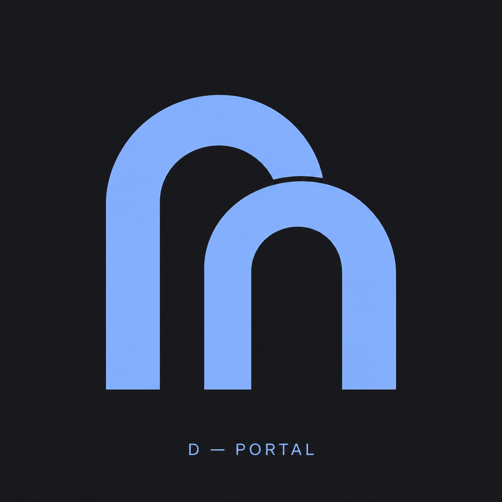
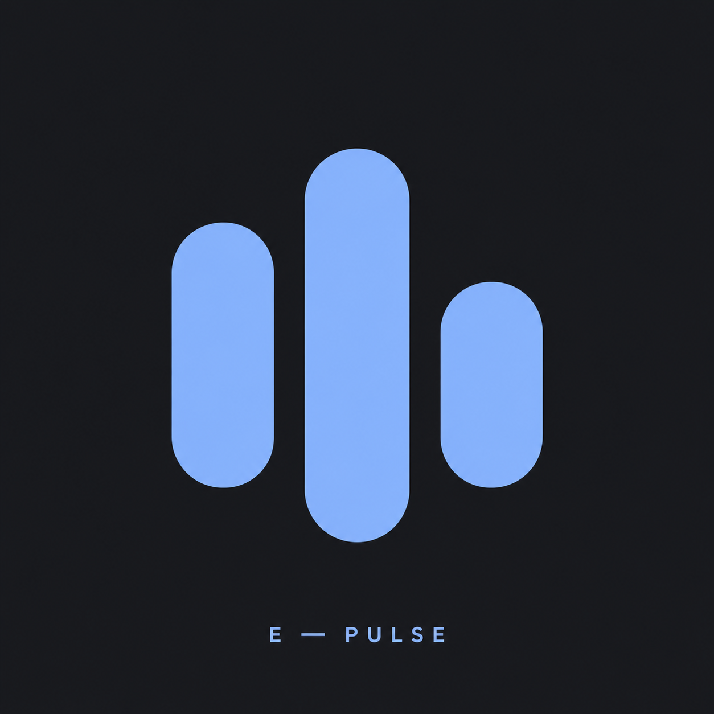
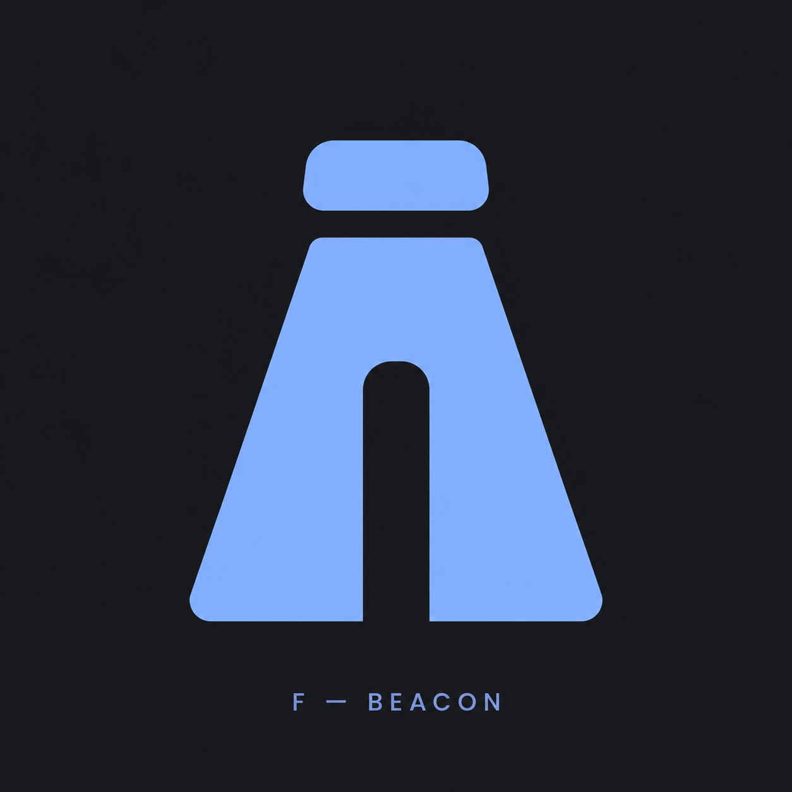
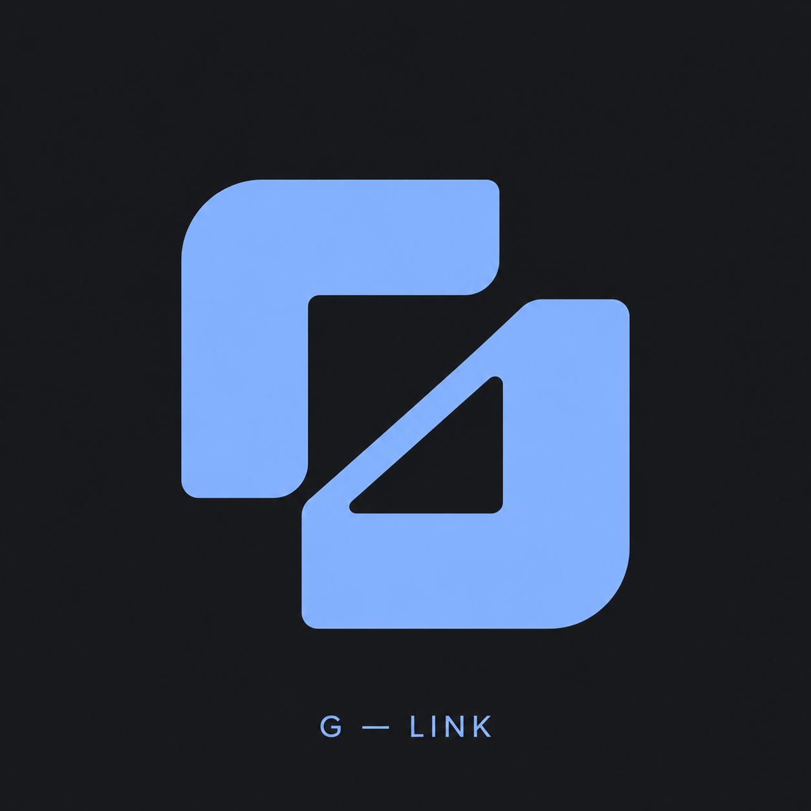
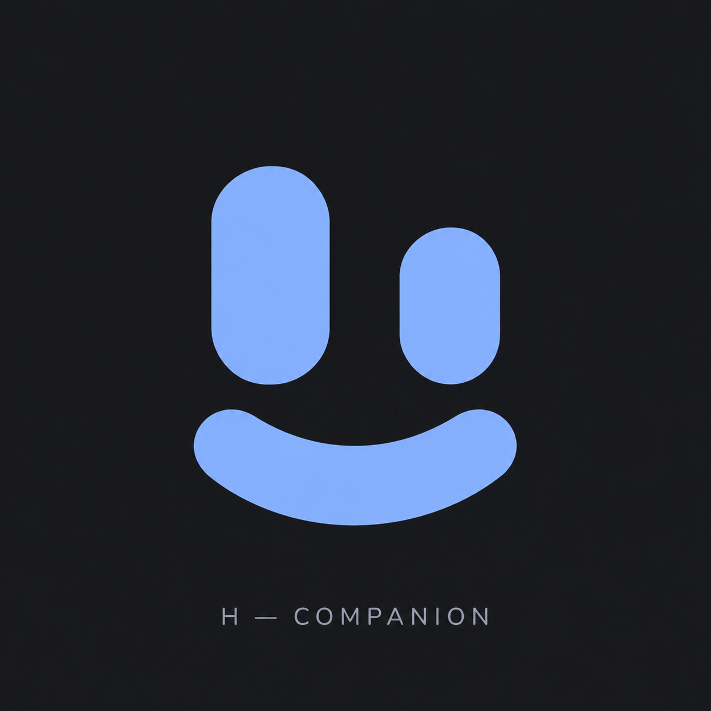
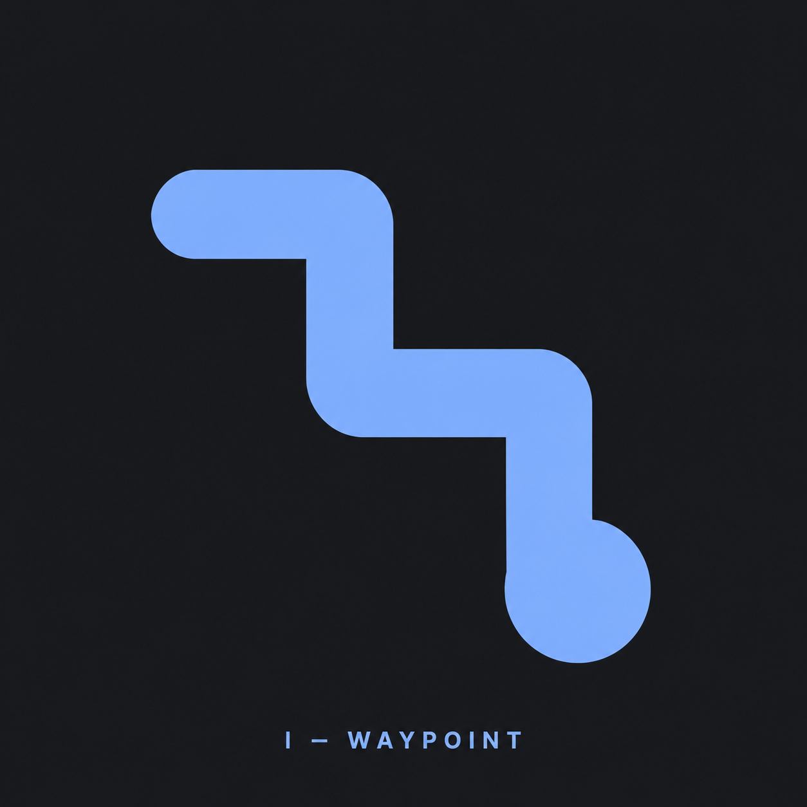
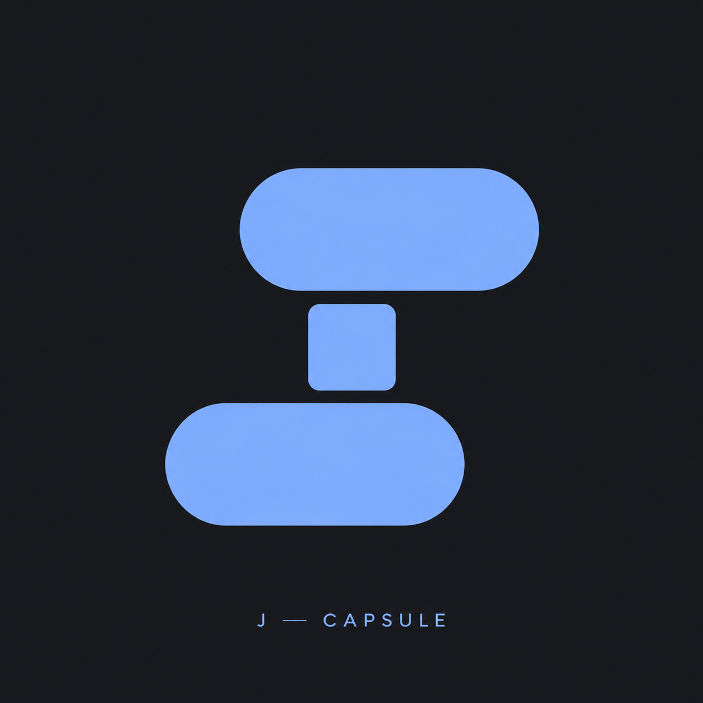
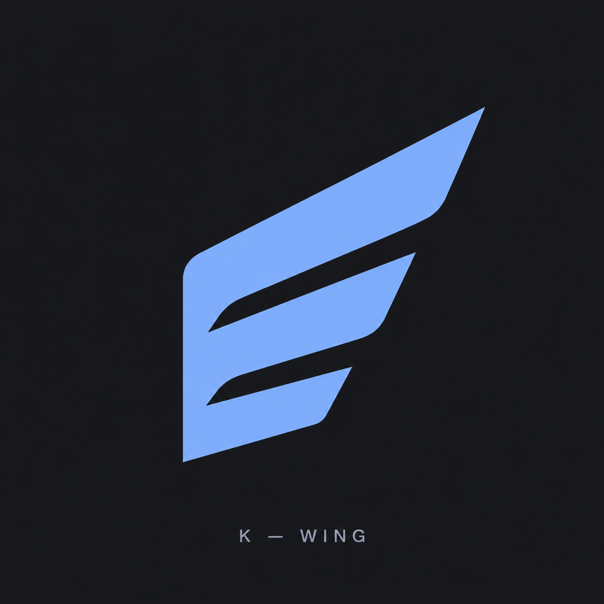
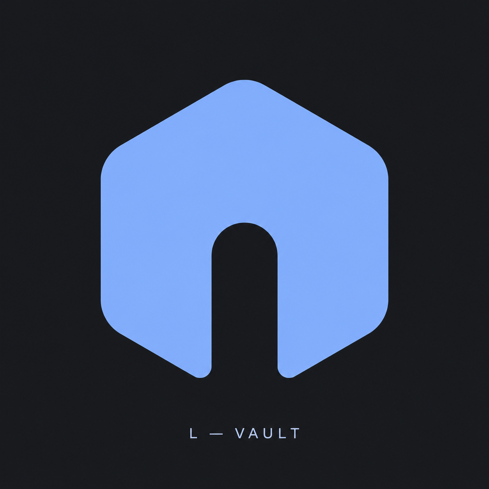
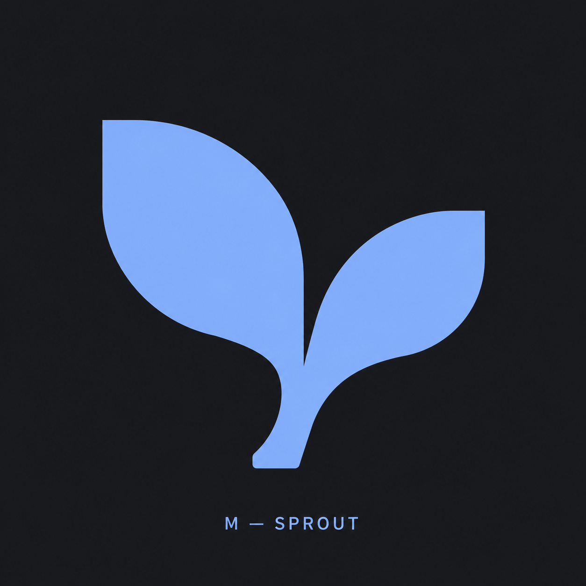

# Ten additional Jarvis logo concepts

Generated on 2026-10-24 with the built-in image generation tool. Select by letter D–M. These are selection previews, including presentation captions.

## D — PORTAL

Prompt:

Use case: logo-brand. Asset type: original Android app logo exploration for Jarvis personal assistant for chat, notes, reminders and recordings. Create ONE square canvas with ONE logo concept. Direction D: PORTAL. Two thick offset rounded doorway arches interlock through clean negative space, suggesting access and helpful presence. Architectural, calm, compact; avoid letters and chain links. Flat vector-like graphic, bold clean shapes, light periwinkle blue #8AB4F8 on solid charcoal #17191D, generous clear space, centered large symbol. Simple enough to reproduce as SVG and recognizable at 24 pixels. Include only a small understated caption 'D — PORTAL' at the bottom, separate from the symbol. Avoid asterisk, rays, starbursts, sun, sparkle, flowers, Claude/Anthropic resemblance, generic AI knots, existing brand logos, enclosing square outlines, gradients, shadows, 3D and mockup objects. Create a new independent design, not a variation of prior conversation images.

## E — PULSE

Prompt:

Use case: logo-brand. Asset type: original Android app logo exploration for Jarvis personal assistant for chat, notes, reminders and recordings. Create ONE square canvas with ONE logo concept. Direction E: PULSE. Three substantial rounded vertical bars of different heights form a compact rhythmic silhouette with a subtle curved baseline. Express listening and responsiveness; avoid microphone illustrations. Flat vector-like graphic, bold clean shapes, light periwinkle blue #8AB4F8 on solid charcoal #17191D, generous clear space, centered large symbol. Simple enough to reproduce as SVG and recognizable at 24 pixels. Include only a small understated caption 'E — PULSE' at the bottom, separate from the symbol. Avoid asterisk, rays, starbursts, sun, sparkle, flowers, Claude/Anthropic resemblance, generic AI knots, existing brand logos, enclosing square outlines, gradients, shadows, 3D and mockup objects. Create a new independent design, not a variation of prior conversation images.

## F — BEACON

Prompt:

Use case: logo-brand. Asset type: original Android app logo exploration for Jarvis personal assistant for chat, notes, reminders and recordings. Create ONE square canvas with ONE logo concept. Direction F: BEACON. A bold upright tapered geometric beacon with a single floating rounded rectangular cap, a clean central notch and stable wide base. Quiet guidance, abstract and distinctive; no light rays or lighthouse illustration. Flat vector-like graphic, bold clean shapes, light periwinkle blue #8AB4F8 on solid charcoal #17191D, generous clear space, centered large symbol. Simple enough to reproduce as SVG and recognizable at 24 pixels. Include only a small understated caption 'F — BEACON' at the bottom, separate from the symbol. Avoid asterisk, rays, starbursts, sun, sparkle, flowers, Claude/Anthropic resemblance, generic AI knots, existing brand logos, enclosing square outlines, gradients, shadows, 3D and mockup objects. Create a new independent design, not a variation of prior conversation images.

## G — LINK

Prompt:

Use case: logo-brand. Asset type: original Android app logo exploration for Jarvis personal assistant for chat, notes, reminders and recordings. Create ONE square canvas with ONE logo concept. Direction G: LINK. Two broad offset L-shaped pieces fit together across a small diagonal negative-space channel to form a compact balanced abstract emblem. Express connection and getting things done; no loops or chain links. Flat vector-like graphic, bold clean shapes, light periwinkle blue #8AB4F8 on solid charcoal #17191D, generous clear space, centered large symbol. Simple enough to reproduce as SVG and recognizable at 24 pixels. Include only a small understated caption 'G — LINK' at the bottom, separate from the symbol. Avoid asterisk, rays, starbursts, sun, sparkle, flowers, Claude/Anthropic resemblance, generic AI knots, existing brand logos, enclosing square outlines, gradients, shadows, 3D and mockup objects. Create a new independent design, not a variation of prior conversation images.

## H — COMPANION

Prompt:

Use case: logo-brand. Asset type: original Android app logo exploration for Jarvis personal assistant for chat, notes, reminders and recordings. Create ONE square canvas with ONE logo concept. Direction H: COMPANION. An original friendly abstract face using two unequal rounded vertical shapes and one broad curved lower shape; extremely restrained, warm, compact, recognizable without becoming a robot head illustration. Flat vector-like graphic, bold clean shapes, light periwinkle blue #8AB4F8 on solid charcoal #17191D, generous clear space, centered large symbol. Simple enough to reproduce as SVG and recognizable at 24 pixels. Include only a small understated caption 'H — COMPANION' at the bottom, separate from the symbol. Avoid asterisk, rays, starbursts, sun, sparkle, flowers, Claude/Anthropic resemblance, generic AI knots, existing brand logos, enclosing square outlines, gradients, shadows, 3D and mockup objects. Create a new independent design, not a variation of prior conversation images.

## I — WAYPOINT

Prompt:

Use case: logo-brand. Asset type: original Android app logo exploration for Jarvis personal assistant for chat, notes, reminders and recordings. Create ONE square canvas with ONE logo concept. Direction I: WAYPOINT. A bold asymmetrical folded route marker formed from one thick bent path with two right-angle turns and one round endpoint. Clear forward movement; avoid arrows, map-pin outlines and existing navigation logos. Flat vector-like graphic, bold clean shapes, light periwinkle blue #8AB4F8 on solid charcoal #17191D, generous clear space, centered large symbol. Simple enough to reproduce as SVG and recognizable at 24 pixels. Include only a small understated caption 'I — WAYPOINT' at the bottom, separate from the symbol. Avoid asterisk, rays, starbursts, sun, sparkle, flowers, Claude/Anthropic resemblance, generic AI knots, existing brand logos, enclosing square outlines, gradients, shadows, 3D and mockup objects. Create a new independent design, not a variation of prior conversation images.

## J — CAPSULE

Prompt:

Use case: logo-brand. Asset type: original Android app logo exploration for Jarvis personal assistant for chat, notes, reminders and recordings. Create ONE square canvas with ONE logo concept. Direction J: CAPSULE. Two substantial horizontal rounded capsules offset above and below a small solid central square create a compact balanced mark. Suggest organized information and focused intelligence; strong simple negative space. Flat vector-like graphic, bold clean shapes, light periwinkle blue #8AB4F8 on solid charcoal #17191D, generous clear space, centered large symbol. Simple enough to reproduce as SVG and recognizable at 24 pixels. Include only a small understated caption 'J — CAPSULE' at the bottom, separate from the symbol. Avoid asterisk, rays, starbursts, sun, sparkle, flowers, Claude/Anthropic resemblance, generic AI knots, existing brand logos, enclosing square outlines, gradients, shadows, 3D and mockup objects. Create a new independent design, not a variation of prior conversation images.

## K — WING

Prompt:

Use case: logo-brand. Asset type: original Android app logo exploration for Jarvis personal assistant for chat, notes, reminders and recordings. Create ONE square canvas with ONE logo concept. Direction K: WING. A single compact abstract wing built from three broad stepped angular feathers joined at a common left spine, sweeping upward to the right. Bold geometric silhouette; no bird body, thin lines or paper airplane. Flat vector-like graphic, bold clean shapes, light periwinkle blue #8AB4F8 on solid charcoal #17191D, generous clear space, centered large symbol. Simple enough to reproduce as SVG and recognizable at 24 pixels. Include only a small understated caption 'K — WING' at the bottom, separate from the symbol. Avoid asterisk, rays, starbursts, sun, sparkle, flowers, Claude/Anthropic resemblance, generic AI knots, existing brand logos, enclosing square outlines, gradients, shadows, 3D and mockup objects. Create a new independent design, not a variation of prior conversation images.

## L — VAULT

Prompt:

Use case: logo-brand. Asset type: original Android app logo exploration for Jarvis personal assistant for chat, notes, reminders and recordings. Create ONE square canvas with ONE logo concept. Direction L: VAULT. An original compact rounded hexagonal solid emblem with one large off-center keyhole-like negative space shaped as a rounded vertical slot opening into its lower edge. Suggest private memory and trust; no literal lock shackle, shield or security badge. Flat vector-like graphic, bold clean shapes, light periwinkle blue #8AB4F8 on solid charcoal #17191D, generous clear space, centered large symbol. Simple enough to reproduce as SVG and recognizable at 24 pixels. Include only a small understated caption 'L — VAULT' at the bottom, separate from the symbol. Avoid asterisk, rays, starbursts, sun, sparkle, flowers, Claude/Anthropic resemblance, generic AI knots, existing brand logos, enclosing square outlines, gradients, shadows, 3D and mockup objects. Create a new independent design, not a variation of prior conversation images.

## M — SPROUT

Prompt:

Use case: logo-brand. Asset type: original Android app logo exploration for Jarvis personal assistant for chat, notes, reminders and recordings. Create ONE square canvas with ONE logo concept. Direction M: SPROUT. Two broad asymmetrical geometric leaf-like forms rise from a short curved stem, creating an abstract friendly companion mark. Substantial graphic shapes, technological precision, no botanical detail or flower. Flat vector-like graphic, bold clean shapes, light periwinkle blue #8AB4F8 on solid charcoal #17191D, generous clear space, centered large symbol. Simple enough to reproduce as SVG and recognizable at 24 pixels. Include only a small understated caption 'M — SPROUT' at the bottom, separate from the symbol. Avoid asterisk, rays, starbursts, sun, sparkle, flowers, Claude/Anthropic resemblance, generic AI knots, existing brand logos, enclosing square outlines, gradients, shadows, 3D and mockup objects. Create a new independent design, not a variation of prior conversation images.

