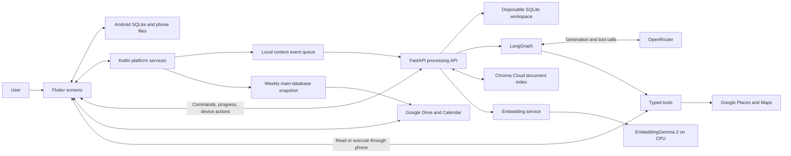
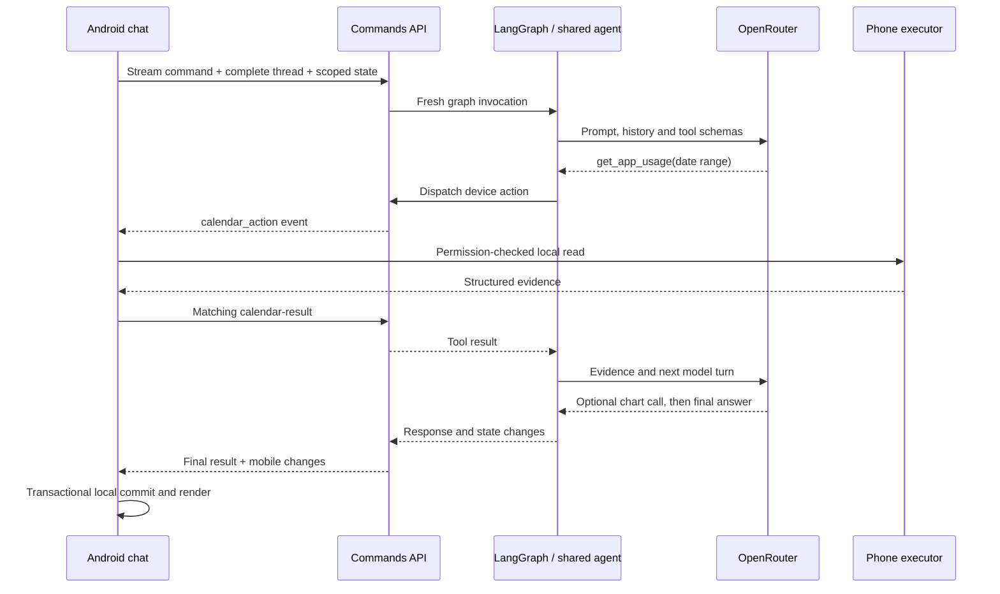
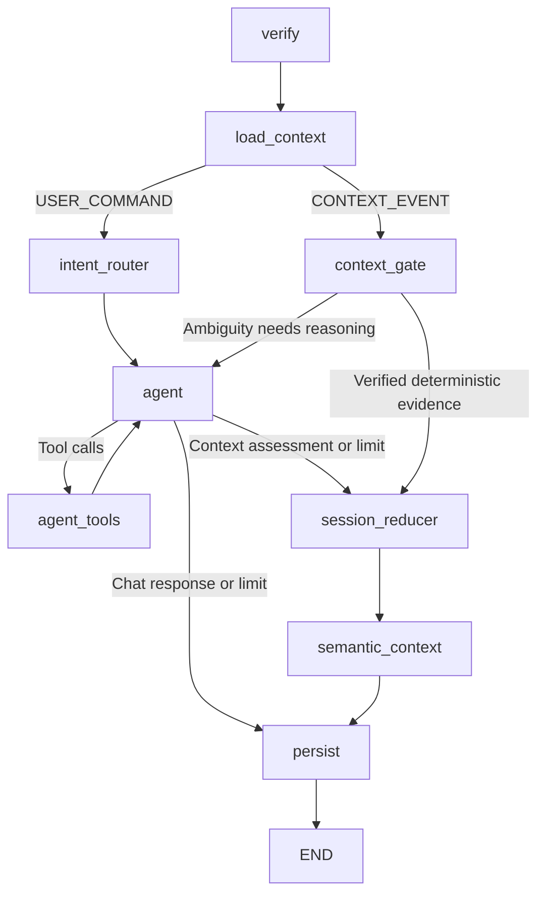

# Jarvis: codebase architecture and end-to-end walkthrough

Departure update (29 October 2026): automatic satellite image cards and estimated
footprints now feed the version 2 departure evidence matcher alongside location,
walking and home Wi-Fi. No map editor is required. See
[departure boundaries](departure-boundaries.md) for the full data flow and limits.

Source review updated: 31 October 2026. This guide describes the current working tree, including staged and unstaged changes. The latest recorded phone/deployment verification below is from 29 October, not a fresh deployment or device check on 31 October. Provider/environment overrides are distinguished from source defaults.

The current architecture uses one shared `AgentNode` and `AgentToolsNode` for independent chat and background assessments. Separate Tier 1/Tier 2 implementations have been removed. Chat now supplies the complete current thread, context assessments use a restricted evidence contract, the phone records explicit powered-off coverage intervals, and a native worker backs up the main phone database to Drive weekly.

## 1. What the application is

Jarvis is an Android personal assistant with three main execution environments:

1. **Flutter/Dart on the phone:** screens, chat, local records, Google integration, permissions, and device action execution.
2. **Native Kotlin on Android:** activity recognition, sensors, background event delivery, usage history, notifications, alarms, and platform APIs.
3. **Python API:** FastAPI receives requests; LangGraph coordinates deterministic context processing and independent invocations of one shared agent runtime; typed tools perform bounded operations.

Two additional services supply AI infrastructure: **OpenRouter** handles language/vision generation, and a separate **embedding inference service** supplies vectors for the existing **Chroma Cloud** document collection.

The central design decision is that **Android owns durable personal application state**. Production Python tools work against an in-memory view of phone records. The phone commits returned changes. Chroma remains persistent storage for document chunks and vectors.



Primary sources: `README.md`, `backend/src/api/main.py`, `backend/src/services/mobile_scope.py`, `mobile/lib/main.dart`, and `docs/android-local-storage.md`.

## 2. Repository map

| Area | Responsibility | Start reading |
|---|---|---|
| `mobile/lib/ui/screens/` | Navigation and feature screens | `main_navigation_screen.dart`, `chat_screen.dart` |
| `mobile/lib/ui/widgets/` | Chat Markdown/charts, approval previews, notes workspace, activity maps | `chat_message_content.dart`, `chat_chart.dart` |
| `mobile/lib/services/` | API transport, command lifecycle, local storage, Google/device execution | `api_service.dart`, `command_client.dart`, `mobile_store.dart` |
| `mobile/lib/models/` | Dart chat, sensor, recording, activity models | `chat_session.dart`, `activity_day.dart` |
| `mobile/android/.../jarvis_collector/` | Kotlin services, workers, receivers and Flutter platform bridge | `MainActivity.kt`, `ContextEventQueue.kt`, `ContextUploadWorker.kt` |
| `backend/src/api/` | FastAPI app, middleware, dependencies, budgets, routers | `main.py`, `routers/commands.py` |
| `backend/src/graph/` | Shared request state and node routing | `builder.py`, `state.py`, `nodes/` |
| `backend/src/cloud/` | Typed agent tools and older model/plan adapters | `agent_tools.py`, `phone_data_tools.py`, `file_memory_tools.py` |
| `backend/src/backend/` | Domain logic, context/session reducers, approvals, command controls | `command_execution.py`, `context_automation.py`, `session_manager.py` |
| `backend/src/services/` | Storage adapters and integrations | `mobile_scope.py`, `record_store.py`, `drive_index.py`, `web_research.py` |
| `backend/src/services/database/` | SQL schema and repository mixins | `service.py`, `schema.py`, `repositories/` |
| `backend/src/models/` | Pydantic schemas and enums | `schemas.py`, `enums.py` |
| `backend/models/embedding/` | Separate real model inference application | `app.py` |
| `tests/` | Backend, Flutter, JVM, embedding, and runner verification | `README.md`, `run.py`, `harness/README.md` |
| `docs/` | Current and historical design notes | Prefer current source and storage guide over dated designs |

Names can be misleading: `cloud/` is mostly model/tool integration code, and `backend/` inside `backend/src/` is domain logic. Neither directory by itself defines a deployment boundary.

## 3. Phone storage and processing API

There is one application storage model: Android owns durable records and the API uses request/active-operation SQLite `:memory:` workspaces. `mobile_only()` always returns true. The former server storage mode and its sync, server Google OAuth, scheduled action and automatic chat archive routes have been removed. Explicit SQLite paths are available for isolated repository tests; production computation requires the phone request scope.

The app mounts `/commands/stream`, request status/cancel/device-result routes, `/context-events`, `/mobile/activity-history`, `/mobile/parse-file`, `/mobile/departure-boundaries`, `/mobile/satellite-map`, file analysis, selected `/drive-index/*` operations, and health routes. Consult `main.py` for the exact filter. Google Calendar, Drive authorization, local chat archives, index progress and weekly database backups remain phone-owned. Tracing and user-content file logging are disabled.

## 4. Storage and ownership

| Data | Durable owner | How Python uses it |
|---|---|---|
| Chat sessions/messages, notes, reminders, places | Phone `jarvis_mobile.db` | Complete current-chat dialogue and tool-requested personal records |
| Tasks, preferences, automations, context rules, journey/context state | Named phone SQLite tables | Seeded/imported into the current workspace |
| Context observations and continuity | Android local records/native telemetry history | Context-event payloads and on-demand reads |
| Daily app usage | Native `jarvis_usage_history.db` | Explicit phone-data tool results |
| Power-off intervals | Phone switch records/preferences | Bounded history reads explain disabled monitoring without inferring user activity |
| Health Connect steps/sleep | Android Health Connect | Explicit permission-checked phone reads |
| Attachments and recording data | Phone files | Temporary source bytes or bounded text for processing |
| Index progress and file catalog | Phone `MobileIndexCatalog` | Index requests carry needed metadata |
| Document chunks and embeddings | Existing Chroma Cloud collection | Scoped semantic retrieval |
| Active command coordination | API process RAM | Progress, action handoff, cancellation, delivery |
| Daily AI accounting | Phone persists usage receipts; each mobile operation starts from phone-supplied budget | Reservations before calls and usage settlement; separate process-local request-rate checks |
| Drive originals and Calendar events | Google | Phone-authorized access and execution |
| Weekly main-database backup | One phone-managed file in Google Drive | No backend backup service; native snapshot/upload |

**Recording path caveat:** not every recording path is private app storage. `SessionStorageService.getStorageDir()` first tries `/storage/emulated/0/Download/JarvisTelemetry`, then app external storage, then app documents. Verify the active recording path before assuming privacy or uninstall behavior from the README.

### The mobile state protocol

1. Android attaches `_mobile_state` to a computation request. This is a bounded working set, not a whole-database upload.
2. `MobileStateMiddleware` creates a `MobileScope` and seeds a SQLite in-memory database.
3. `DatabaseService` uses SQL repository mixins. `RecordStore` uses `SqlStore` and parameterized SQL over named entity tables. The document compatibility layer has been removed. Backend agent continuity lives in `state_*` tables, separate from domain tables with overlapping entity names.
4. The baseline records and their versions are remembered. A selected tool can request additional local records; `import_read()` adds them as baseline data without overwriting an earlier change from the same operation.
5. Python returns `_mobile_changes`: operation ID, upserts/deletes, baseline versions, `agent.domain` SQL rows, `agent.records` rows identified by `table`/`id`/`uid`, `agent.removed` keys, notifications and cumulative usage totals for the operation.
6. `MobileStore.apply()` commits changes in a phone transaction, deduplicates receipts and usage, converts cumulative usage receipts into nonnegative deltas, and protects phone edits newer than the versions used by the command.
7. The Python workspace is released after the operation no longer needs it. Active streamed commands retain their scope while waiting for phone responses.

The graph's `persist` node writes into this working view in mobile mode. Its name does not imply a durable backend database or permanent server chat memory.

### Named SQL records and completed conversion

Android `MobileSqlStorage` uses per-entity `domain_*` and `record_*` tables shared by native and Flutter code. Backend `SqlStore` uses named entity tables and `state_*` continuity tables inside the temporary phone workspace. Scalar fields have SQL columns; nested/extra values use JSON columns. The wire contract identifies a record by table, ID and owner, rather than a collection path or document reference.

On 28 October 2026, the existing phone database was converted and all 2,244 old rows were verified against the converted SQL values. Existing reminder status and historical observation timestamps were preserved. The old generic tables, temporary migration archives and compatibility readers/conversion code were then removed. The final application operates only on the converted SQL entities; it does not keep an old-record import path or a second copy of the document-style store. Context-history records and timestamp-error quarantine remain separate current evidence.

## 5. End-to-end chat request

Example: **“Show yesterday's app usage as a pie chart.”**

1. `ChatScreen` saves/displays the user turn and loads the complete current thread from SQLite, independently of UI pagination. It merges unsaved in-memory messages, excludes the current request from history, and supplies thread/request IDs, file references and device capabilities. An incomplete history read fails visibly rather than silently sending a partial thread.
2. `ApiService` builds the payload and supplies a private session capability for device action/result exchange. `CommandClient` tracks the lifecycle and opens `POST /commands/stream`.
3. FastAPI middleware handles the mobile state workspace, payload/rate limits, power gate and request envelope. The command route claims the request and starts graph work.
4. LangGraph executes `verify → load_context → intent_router → agent`. Every natural-language chat request reaches the shared agent runtime, including greetings.
5. The model calls `get_app_usage` with explicit IST calendar dates. Chat does not answer this through keyword interception.
6. The tool dispatches a phone action. An SSE event historically named `calendar_action` carries the request; it is now a general device-action channel.
7. Android's `PhoneDataExecutor` validates the date window and existing Usage Access, then reads native usage records. It returns raw structured durations, coverage and missing-data information.
8. Android posts the result to the matching command's `calendar-result` endpoint. Session/action matching prevents an unrelated action result from satisfying the wait.
9. `AgentToolsNode` adds a `ToolMessage`. The model sees the actual records and may call `render_chart`, which validates a pure chart payload.
10. The model supplies the final Markdown answer. `persist` finishes working-state changes; the command response includes costs and `_mobile_changes`.
11. Android commits the changes and final assistant turn. `ChatMessageContent` renders Markdown; `ChatChart` renders the fenced chart JSON.



This is SSE progress/control and final-result streaming; it should not be assumed to be token-by-token model text streaming. Progress messages, device-action requests and the final response are distinct event types.

## 6. LangGraph architecture

`JarvisState` is a typed dictionary carrying request identity, normalized context, records, chat/model messages, tool outputs, decisions, step counts, response and errors. A graph invocation is fresh; `workflow.compile()` is not supplied a persistent checkpointer.



| Node | Main job |
|---|---|
| `verify` | Validate/normalize the request, establish run identity/context packet |
| `load_context` | Load the appropriate working context; user commands use on-demand personal data |
| `intent_router` | Establish conversational input/routing information |
| `agent` | Shared model invocation, budget/cancellation checks and validated output contract |
| `agent_tools` | Execute the invocation's allowlisted typed tools and feed observations back |
| `context_gate` | Detect conflicts and request a restricted assessment only when needed |
| `session_reducer` | Deterministic movement/journey state machine |
| `semantic_context` | Deterministic ledger for physical states such as parked, dwelling, visiting |
| `persist` | Record graph results in the active storage view |

Chat and background work run independent invocations of the same agent and tool-loop implementation. They share `agent_messages` and `agent_step_count` field definitions, never a live message history or queue. Background context uses its own compact evidence prompt, restricted read-only tools and a validated `ContextAssessment` with evidence provenance. Tool registration and execution enforce that scope; telemetry cannot acquire note, calendar or reminder write permissions. Invalid output, missing evidence or provider failure leaves context uncertain and cannot promote a journey from conflicting raw evidence.

Android services, workers, reducers, alarms and reminder matching remain deterministic. They do not need a model invocation when evidence is sufficient. Context tools call shared domain services in `services/context_evidence.py`; the same calculations can be used directly by background code. `semantic_context` means physical situation state here; it is a different subsystem from Chroma document embeddings.

## 7. Models, prompting and memory

The following are **source defaults**, not a claim about secret environment overrides or the deployed service:

| Role | Default | Invocation path |
|---|---|---|
| Shared chat/context agent | `z-ai/glm-5.3-flash` | `graph/nodes/agent.py` |
| Native image/video file analysis | Defaults to shared LLM model | `api/routers/file_memories.py` |
| Native PDF analysis | `google/gemini-3.8-flash` | `native_payload()` with native PDF parser configuration |
| Satellite image interpretation | `OPENROUTER_MODEL_MULTIMODAL`, defaulting to shared LLM | `services/satellite_vision_service.py`; boundary calls use 8,192 output tokens, low reasoning effort and JSON output |
| Public web retrieval | Shared LLM model plus OpenRouter server tools | `services/web_research.py` |
| Embeddings | `google/embeddinggemma-2` | Separate CPU inference service |

OpenRouter uses the OpenAI-compatible `/chat/completions` protocol through LangChain `ChatOpenAI` for the shared runtime. Background assessments use the same model with restricted capabilities. `LLM_MODEL` in `.env` and `.env.example` selects the shared model; `LLM_OUTPUT_TOKENS` controls the conversational output allowance. The source contains inference integration and hand-authored rules, not a training or LLM fine-tuning pipeline.

Chat receives a system prompt embedded in `agent.py`, time/date information, the complete current-chat dialogue, supplied file references, explicitly recalled prior answers, selected context, and typed tool schemas. Each user/assistant turn receives its own role number and UTC/IST timestamp, or an explicit unknown-time marker. Visible application errors are retained and marked as errors, while hidden upload notices are filtered. Personal datasets and GPS are obtained through tools when needed. Tool observations are fed back to the model before final synthesis. Files/web pages are described as untrusted evidence and cannot authorize actions. New attachments initially use a smaller routing prompt/tool set for reading/saving, retaining the full thread; mixed tasks can continue into the full assistant.

`respond_to_user` supplies structured message/intent/place/clarification fields and is intercepted by the agent as final output. Plain final text is also accepted. If a turn requests actions alongside a response, the actions run first and the agent continues from their results.

Conversation memory has several distinct layers:

- **Full local history:** Android stores the actual conversations.
- **Working chat context:** complete, timestamped current-chat turns supplied to an invocation.
- **Prior-answer recall:** bounded relevant answers supplied with provenance, not an unlimited transcript.
- **Agent scratch messages:** model/tool messages for the current graph run.
- **Physical context memory:** observations, journeys and semantic situation state.
- **Document retrieval:** Chroma passages with source/version/locator metadata.

There is no persistent LangGraph thread checkpoint to substitute for the phone history. Dart/Python history helpers normalize the full current dialogue; the former 24-message/16,000-character cutoff is gone. Relevant recall from other chats remains separately bounded and cannot establish the order/timestamps of this chat. A recognized provider context-window overflow returns an explicit new-chat error, with the original conversation still saved. The API's request-size limit and provider context/budget limits still apply; full history is not an unlimited model context window.

## 8. Tool groups and action controls

Chat binds 53 typed tools assembled by `build_agent_tools()`, extended by shared context, calendar, file, web, phone-data and chart modules. Background assessment registers nine read-only `build_context_tools()` capabilities plus `submit_context_assessment`, for ten schemas. The model chooses tool names and arguments; Python/Android enforce validation and execution. The older `FunctionRegistry`/plan executor is a separate compatibility path, not the dispatcher of the current ReAct loop.

| Group | Representative active tools | Executor/data source |
|---|---|---|
| Reminders | `create_reminder`, `update_reminder`, list/search/delete/restore operations | Domain repositories and local Android alarms |
| Notes | `create_note`, `append_note`, `update_note`, `merge_notes`, list/search/delete/restore | Versioned local records via Python tools |
| Tasks | create/list/update/status/delete | Domain SQL repositories |
| Places | save/list/delete, `get_current_location`, `search_nearby_places` | Phone GPS, saved records, Google Places |
| Physical history | `recall_context_history` | Phone observations and derived activity history |
| Context evidence | `get_current_context`, `get_motion_evidence`, `check_geofence`, `get_monitoring_status`, `preview_reminder_match` | Shared domain services; read-only assessment scope |
| App usage/health | `get_app_usage`, `get_health_records` | `PhoneDataExecutor`, native usage, Health Connect |
| Google Calendar | list calendars/events, get/create/update/delete event | Phone-authorized Google API requests |
| Files | `search_file_memories`, `analyze_saved_file`, `save_file_to_drive` | Phone cache/Drive, extraction, Chroma, native analysis |
| Web | `search_web`, `read_webpage` | OpenRouter server search/fetch |
| Visual output | `render_chart` | Pure numeric/chart validation |
| Satellite | `inspect_satellite_view` | Static Maps imagery and model analysis |
| Response | `respond_to_user` | Final structured response channel |

The complete mobile tool inventory, grouped by domain:

- Context evidence: `get_current_context`, `get_motion_evidence`, `get_monitoring_status`, `check_geofence`, `preview_reminder_match`, `lookup_nearby_places`, `match_vibration_signature`, `check_saved_geofences`, `check_user_geofences`.
- Reminders: `create_reminder`, `update_reminder`, `consolidate_reminders`, `list_reminders`, `search_reminders`, `delete_reminder`, `delete_all_reminders`, `restore_reminder`.
- Notes: `create_note`, `append_note`, `update_note`, `merge_notes`, `list_notes`, `search_notes`, `delete_note`, `delete_all_notes`, `restore_note`.
- Tasks: `create_task`, `list_tasks`, `update_task`, `update_task_status`, `delete_task`.
- Places/location/vision: `save_place`, `list_saved_places`, `delete_place`, `get_current_location`, `search_nearby_places`, `inspect_satellite_view`.
- Physical context: `recall_context_history`.
- Calendar: `list_google_calendars`, `list_calendar_events`, `get_calendar_event`, `create_calendar_event`, `update_calendar_event`, `delete_calendar_event`.
- Files: `search_file_memories`, `analyze_saved_file`, `save_file_to_drive`.
- Web: `search_web`, `read_webpage`.
- Phone data: `get_app_usage`, `get_health_records`.
- Formatting/response: `render_chart`, `respond_to_user`.

The initial attachment router temporarily offers `analyze_saved_file`, `save_file_to_drive`, `respond_to_user`, and `continue_with_assistant`. Calendar and Drive actions execute through the phone's typed tools and authorization.

The nine context tools share `ContextEvidenceService`, `geofence_result()` and `vibration_evidence()` with deterministic processing. `preview_reminder_match` neither consumes trigger state nor arms/delivers alerts. `get_monitoring_status` reports backend-observed health; unknown live Android settings/permissions stay unknown. Continuous sensing and OS permission control remain Android-owned.

Background final output is a Pydantic `ContextAssessment`: action, resolved vehicle/place, confidence, uncertainty, reasoning and evidence IDs. Extra fields and nonfinite confidence values are rejected. Only ACCEPT/REJECT are permitted; session lifecycle actions remain reducer-owned. ACCEPT requires confidence at least 0.75, uncertainty at most 0.25, and a cited current event. Vehicle claims require corroborating classifier evidence; place claims require an accurate observed GPS fix and a matching saved geofence. The runtime checks cited event/tool IDs and assigns provenance itself. Rejection clears speculative vehicle/place values. Invalid output, failed provider calls or exhausted budgets produce conservative UNKNOWN/REJECT rather than promoting conflicting evidence.

Context tools provide nearby-place lookup, motion evidence, saved-geofence checks, reminder previews and monitoring status. The vibration matcher is a hand-authored heuristic; generic frequency/energy features cannot establish a particular motorcycle model. Missing measurements stay uncertain, and numerical confidence is not a measured live recognition accuracy.

Routine explicitly requested personal-record writes are allowed without an extra modal, including note merges, bulk note/reminder Trash operations and restores. Ambiguous targets need clarification. Tools outside the routine allowlist, including task/place deletion and reminder consolidation, use device approval handling; phone Calendar writes use previews/approval. Tool authorization is not equivalent to an Android OS permission grant.

Repeated tool arguments, duplicate writes, cancellation, elapsed time and model/tool budgets are checked by runtime code. Identical writes reuse their result within a command; selected independent reads can run with up to four worker threads, while writes remain ordered. Consecutive file reads can be batched into a phone operation. A selected tool result must actually indicate success before the assistant should claim completion. Reminder argument contracts allow bounded correction after malformed calls rather than pretending the first attempt succeeded.

Device actions use an unguessable request capability, action ID and expiry. The route names `calendar_action` and `calendar-result` are historical; local reads, phone health/usage, file actions, location and approval exchange also use them.

## 9. Sensor/context and reminder lifecycle

The background path begins with Android receivers/services rather than the chat UI:

1. Activity Recognition transitions, passive/location evidence, bounded IMU bursts and ambient context produce timestamped observations.
2. Native code queues events locally. WorkManager schedules upload/retry rather than requiring an open Flutter screen for every observation.
3. `ContextUploadWorker` sends `/context-events` with active rules, nearby saved places and recent continuity state from `MobileRecords`.
4. The graph normalizes evidence. `ContextResolver` detects conflict; unambiguous and sparse events proceed through deterministic reducers without a model invocation.
5. `SessionManager` deterministically updates movement/journey states and parking/dwell continuity. The semantic ledger maintains physical contexts.
6. After persistence, `ContextAutomationService` evaluates eligible fresh events against reminder/rule conditions. Internal telemetry bursts are restricted; eligible classified car evidence has additional conditions.
7. Changes and notification records return to Android, which commits them and delivers native notifications/alerts.

Time-based reminders are scheduled locally with Android AlarmManager. Context-dependent reminders require fresh observations and reachable processing when backend computation is needed. An LLM does not wake on every timer tick and decide whether a deterministic reminder should ring.

Native files to read: `ActivityRecognitionRegistrar.kt`, `ActivityTransitionReceiver.kt`, `ContextEventQueue.kt`, `ContextLocationCapture.kt`, `ContextUploadWorker.kt`, `MobileRecords.kt`, `ReminderAlerts.kt`, `ReminderAlertPolicy.kt`, `JarvisPower.kt`.

### Departure evidence and satellite setup

New departure policies use version 2: `trigger=exit`, `evidence_mode=boundary_motion_wifi`, and a saved origin reference. The LLM compiles the reminder intent through typed tools; deterministic code evaluates subsequent observations. Older active departure policies upgrade in place during foreground setup. Version-1 category/journey policies remain a separate matching branch; the removed 200 m rule should not be interpreted as removal of every radius-based condition in the codebase.

`departure_setup.py` obtains a boundary estimate at creation or foreground refresh. The phone checks at health/resume with a 15-minute in-process throttle; successful estimates are reused for seven days and negative results for six hours. One uncached origin is processed per setup request. The vision service tries zoom 19 and, only after an unclear geometry result, one zoom-18 image. Network/provider/budget failures do not trigger the second paid inference. The provider key and image bytes do not enter chat history; validated geographic vertices, provenance and uncertainty go into `places.boundary_json` in phone SQLite schema 10.

The native worker supplies active reminder continuity, including the inside reference, calibrated hashed home Wi-Fi ID, recent walking evidence and candidate outside fixes. The matcher compares timestamps as instants; a newly captured GPS fix may be up to two minutes before or after event time. A better inside reference survives less accurate later fixes, with a 30-minute anchor age bound.

Departure requires verified walking/on-foot/running plus positional evidence. An estimated footprint crossing must clear both GPS and outline uncertainty. Alternatively, calibrated Wi-Fi loss and conservative displacement beyond both location uncertainties can support departure without a footprint. With fresh Wi-Fi-away evidence, confirmation needs two increasing, distinct GPS fix timestamps spanning five seconds. Without Wi-Fi-away evidence, a footprint and three fixes spanning ten seconds are required. Wi-Fi loss or walking alone cannot trigger. Unknown Wi-Fi is not treated as disconnection; continued home Wi-Fi can be outweighed by repeated clear footprint crossings. These spans are minimum evidence requirements, not promised alert latency.

`SatelliteMapCard` renders the actual attributed Google PNG from `/mobile/satellite-map`, with a read-only estimated outline when available. It is accessible from chat and Apps → Reminders → Satellite view. There is no map editor. Image bytes remain transient; inferred geometry is not a surveyed fence. The final 29 October Home attempt completed but yielded no usable outline at either zoom. The calibrated GPS/walking/Wi-Fi path remained active. See [departure boundaries](departure-boundaries.md) for exact validation and the private offline replay result.

### Requested schedules and bounded work

| Operation | Current source behavior |
|---|---|
| Google activity samples | Requested every 30 seconds; confidence/agreement filters gate accepted samples |
| Activity transitions | Event-driven Android ENTER/EXIT delivery |
| Location updates | Approximately 30 seconds moving/dynamic; 120 seconds ordinary idle, with distance/minimum-interval gates |
| Dwell follow-up / periodic checkpoint | Requested after 100 seconds / every 15 minutes |
| Live uploads per worker | Up to four HTTP events, processed serially |
| Worker history archive | Up to 100 per plan, 500 per worker |
| Worker time budget | Approximately 45 seconds between operations; active HTTP retains its own timeout |
| Upload network timeout | 10-second connect, 60-second read |
| Retry delay | 5, 10, 20, 40, then at most 60 seconds |
| Historical threshold | Events at least five minutes old are history-only; no retrospective reminder/LLM/Places work |
| Foreground departure setup | 15-minute client throttle; 150-second client request timeout |

Android schedules are requests, not guaranteed delivery deadlines. Unresolved location capture does not prevent later ready events from being selected. The durable queue uses one coalesced KEEP drain and a replaceable wake/watchdog, rather than one upload chain per observation.

`LocalMotionMonitor.kt` is explicitly a shadow evaluator: provisional local motion candidates do not independently change authoritative journeys or fire reminders. Distinguish it from the active evidence and backend reducer paths.

App usage has its own native history/cache pipeline. The Overview preloads recent daily summaries; chat requests exact structured usage records. Steps and sleep come from Health Connect, not inference from movement or an idle phone. Missing data and denied permissions are unknown rather than zero.

`ApiService` persists the selected API URL and user header through the native context-runtime channel. `ContextUploadWorker` uses that selection after process death or reboot. Backend `get_current_user()` returns the fixed local UID.

## 10. Files, indexing and retrieval

There are two different questions: **“Which file contains this?”** and **“What does this file say?”** A filename match is not proof of content.

### Indexing

1. Android obtains authorized file metadata and source bytes from Drive or a local attachment.
2. The file catalog/progress remains on the phone. Uploads for processing are bounded and temporary.
3. Readers handle PDF/text, Office documents, archives, media and selected binary/database metadata. Unsupported/unreadable content produces coverage information instead of fabricated text.
4. Text is split into overlapping bounded chunks with page/character/section locators. Image/media units use bounded sizes; audio/video are segmented.
5. The embedding service runs pinned `google/embeddinggemma-2`, revision `914f7f89142e33e77833254d9c9b90c3cef7303b`, on CPU and returns normalized 768-dimensional vectors.
6. Chroma collection `jarvis-drive-eg2-768-v1` stores vectors, chunk text and metadata: owner/account/file ID, source version, digest, generation, locator and coverage.
7. Identical completed digests can reuse existing vectors. A new generation is marked complete before older generations are removed; failed generations are cleaned up.

### Retrieval and answering

1. Embed the query using the same model/revision.
2. Search within the owner's account scope. Initial results can be locators/metadata rather than original content.
3. The phone rechecks current Drive access and version.
4. Fetch matching complete passages restricted to the authorized file/version set.
5. Feed verified passages to the conversational model, or analyze the original file when excerpts/media locators are insufficient.
6. Cite source locators and disclose partial/metadata-only coverage.

An image/audio/video embedding is not a transcript or visual description. `format_passages()` labels media references accordingly. Native PDF/image/video analysis is a separate model call, with a 20 MB source limit. The parse/indexing path has its own 128 MB processing limit and bounded extracted text.

Embedding `/embed` accepts text/image/audio/video items, up to 16 per request, with bounded media and parallelism. Remote embedding calls use a Google identity token; localhost can run without IAM headers. Health validates model identity/revision/dimension. This is distinct from ordinary chat generation.

## 11. Web, Google and chart integrations

**Public web:** `WebResearch` sends only the selected query or URL to OpenRouter's search/fetch server tool, not personal records or full dialogue. Search and fetch have bounded retrieval use, output and cost reservation. Search requires usable citations and a complete result; direct fetch requires executed-tool evidence and a structured successful extract. Transport uncertainty retains the reservation instead of silently replaying paid work. Public evidence cannot authorize bookings or private actions.

**Google:** Android restores/connects the Google account and authorizes Drive/Calendar requests. Normal attachments stay in app-private attachment files; `save_file_to_drive` is an explicit action. Calendar writes show before/after/guest previews, require approval, and persist an action receipt before contacting Google. Existing-event mutations require an ETag. An interrupted pending mutation becomes uncertain rather than automatically replaying. Server OAuth and server scheduled Google service modules have been removed.

**Markdown/charts/maps:** assistant text is stored as Markdown. Flutter supports tables/code/source links and validates fenced `chart` JSON for bar/line/pie displays. Charts are limited to three per reply; a chart has at most 24 labels and three series, and a pie has one nonnegative series with at most 12 labels. Invalid charts stay readable code. No chat HTML or JavaScript executes. Arbitrary external images remain links; a validated `satellite-map` card loads imagery through the configured application API, never a model-supplied image URL. Trusted satellite tool cards are preserved even if the final model summarizes the tool prose.

## 12. Budgets, cancellation and failure boundaries

| Control | Current source value/behavior |
|---|---|
| Daily AI money allowance | USD 0.50; reset at midnight Asia/Kolkata |
| Production command request allowance | 15 requests/minute in budget profile; HTTP middleware has a separate broader sliding-window limit |
| Daily token/call ceiling | Disabled in production profile; money allowance governs |
| Chat LLM output allowance | 16,384 completion tokens, including reasoning/final output |
| Other generic per-call output setting | 2,048; not the ceiling for every specialized call |
| Graph agent iteration setting | 50 |
| Active command runtime | 600 seconds |
| Command model rounds | 24 |
| Command tool executions | 48; repeated identical tool steps are separately limited |
| Phone action expiry | 180 seconds |
| Completed mobile command delivery window | Approximately 60 seconds in process RAM |

The runtime reserves estimated cost before generation, then settles against provider usage/reported cost. USD cost is stored using integer nanodollars. Specialized file, web and vision calls also consume allowance. Stored price entries are source configuration, not a guarantee of current provider pricing.

The shared runtime disables SDK retries and uses a 60-second transport timeout. A truncated chat generation has a bounded single regeneration with an output allowance up to 32,768, preserving completed observations and rejecting partial tool calls before execution. Background assessment has four graph turns and four actual model calls including retries, eight tool executions, at most 32,000 characters of message content, a 2,048-token initial output allowance (4,096 on a bounded incomplete-generation retry), and a 90-second elapsed-time guard checked between operations; invalid or unavailable output remains uncertain. The elapsed-time guard is cooperative, rather than a hard interrupt of an active HTTP call. This is different from automatically replaying a transport request whose acceptance/billing is unknown.

The daily ledger is not a global project billing cap across phone resets, server restarts and replicas. Embedding, Chroma, Maps and Cloud Run compute have separate service costs.

Cancellation is checked between graph/model/tool steps and through phone executors. It cannot guarantee reversing an external action already accepted by Google. If the backend process disappears, in-flight coordination disappears; the client must not automatically replay an unknown paid request as though it had never executed. Keep the app open while a conversational command needs phone reads or Google actions.

## 13. Identity, permissions and observability

The main application API is a single-user design: `api/auth.py` returns `jarvis_local_user`. `X-User-ID` influences request limiting but does not establish authenticated multi-user identity. File-memory routes use a separate random 64-hex capability whose hash scopes ownership, and device result exchange uses private request capabilities.

These capability checks should not be confused with a complete JWT/OAuth login system for every API route. Deployment network/IAM protections must be evaluated separately. CORS is permissive in the source app factory.

Android retains permission checks for location, Usage Access, Health Connect, notifications and Google authorization. A prompt/tool invocation does not silently grant an OS permission.

The processing API disables LangSmith tracing and user-content file logs. Correlation/progress/audit infrastructure remains in source, but working-state/audit data is not a persistent server observability database.

## 14. Test architecture and what each layer proves

The canonical runner is `tests/run.py → tests/harness/run.py`. It runs six suites. Backend/agent/harness runs inject explicit isolated SQLite handles, dummy model credentials and a socket-blocking pytest plugin. Plugin autoload is disabled and pytest-asyncio is loaded explicitly. Plain `pytest` is not equivalent to the canonical offline runner.

| Suite | Inventory at review | What it verifies | What it does not establish |
|---|---|---|---|
| Backend | Last recorded full integration run: 619 passed; 2 live probes deselected | API, shared runtime, tools, records, budgets, context, file and integration contracts with offline doubles | Live model accuracy or deployed behavior |
| Flutter UI/services | Last recorded full integration run: 179 passed | Widget rendering, local state, command client, executors, satellite display, backup controls and power history | Real phone battery, permission UX or hardware behavior |
| Android JVM | Last recorded integration run: 44 passed | Pure Kotlin motion/location/usage/alert/backup policy logic | Full device/service lifecycle or OEM background restrictions |
| Embedding | 1 test file; 14 parameterized cases from 7 definitions | Real pinned model inference, normalization/dimensions, retrieval and media bounds | Chat-model or live web accuracy |
| Agent benchmark | 24 selectors; default 3 repeated fresh pytest runs | Scripted-provider workflow correctness and regression timing | Live LLM reasoning accuracy, provider latency or real token bills |
| Harness | 3 files; 14 cases | Report validation, timeouts/process cleanup, embedding configuration | Product feature correctness by itself |

### Representative end-to-end regression cases

The integration counts above are recorded 29 October results, not tests rerun during this documentation review. Subsequent hardening passed 67 focused departure/continuity/card cases and 79 satellite/provider cases; those overlap other runs and are not an additional unique-case total. The final zoom metadata change has a targeted Flutter regression. See `test_boundary_departure.py`, `test_satellite_boundary.py`, `satellite_map_test.dart`, and `LocationEvidenceTest.kt`. Live imagery display was checked on the phone; a successful inferred Home outline and a new physical departure after installation were not established.

| User/system scenario | Required behavior | Main tests |
|---|---|---|
| Greeting or ordinary knowledge question | Reach model; preserve complete final reply | `test_graph_builder.py`, `test_complete_reply.py`, `test_rich_reply.py` |
| Ambiguous background context | Use the same runtime with restricted tools, no private chat/history, valid observed evidence and conservative failures | `test_agent_runtime.py` |
| Shared context evidence tools | Reuse geometry/freshness checks; preview reminder without consuming trigger state or delivering it | `test_context_tools.py` |
| Full current-chat follow-up | Preserve old turns/order/timestamps and visible error markers; fail clearly on provider context overflow | `test_conversation_memory.py`, `test_agent.py`, Flutter `conversation_memory_test.dart` |
| Explain a monitoring gap | Show explicit off intervals separately from unknown activity and unexplained gaps | `test_power_history.py`, Flutter `power_history_test.dart` |
| Weekly database backup | Schedule Sunday work, protect current revision, show native queue/status in Settings | `DatabaseBackupPolicyTest.kt`, Flutter `database_backup_settings_test.dart` |
| App usage chart / sleep follow-up | Choose correct phone dataset/date window; return evidence to model | `test_phone_data_tools.py`, Flutter `phone_data_executor_test.dart`, `health_question_test.dart`, `chat_rich_content_test.dart` |
| List/search records | Read bounded phone data on demand, no eager full personal context | `test_on_demand_context.py`, `test_mobile_only_storage.py`, `test_parallel_context.py` |
| Append a dated note | Preserve prior content and dates; avoid accidental duplicate/replacement | `test_note_append.py`, Flutter `notes_workspace_test.dart` |
| Merge or delete records | Approval/target rules enforced, duplicate calls safe | `test_note_merge_approval.py`, `test_routine_write_approval.py`, `test_trash_roundtrip.py` |
| Create context reminder with malformed arguments | Surface validation, allow bounded repair, do not falsely claim success | `test_reminder_tool_recovery.py`, `test_reminder_follow_through.py` |
| Alarm delivery or activity trigger | Convert a fresh activity start to the same phone reminder and clock deadline; duplicate/stale events do not repeatedly alert | `test_reminder_delivery_modes.py`, `test_activity_reminder_timers.py`, `ReminderAlertPolicyTest.kt` |
| Sensor transition/parking/return trip | Preserve continuity and evidence; sparse events do not invent certainty | `test_session_continuity.py`, `test_sparse_context_events.py`, `test_motion_evidence.py` |
| Ask about a file rather than its name | Search content, recheck access/version, synthesize from real evidence | `test_content_search_flow.py`, `test_file_question_routing.py`, `test_file_memories.py` |
| Interrupted/changed file index | Preserve valid generation, scope ownership, skip unchanged content | `test_drive_index.py`, `test_streaming_drive_index.py`, `test_local_bulk_index.py` |
| Web price/source request | Verify tool execution/citations; never fabricate success; account inner calls | `test_web_research.py`, `test_durable_budget.py` |
| Retry after network failure/cancel | Match private session/action, retain uncertain paid holds, avoid duplicate writes | `test_command_progress.py`, `test_durable_budget.py`, Flutter `command_client_test.dart` |
| SQL records and operation isolation | Enforce owner/key contracts and transactional rollback; retain phone edits and explicit row changes | `test_sqlite_store.py`, `test_local_record_store.py`, `test_mobile_scope_transactions.py`, device SQL instrumentation |
| Background upload backlog | Keep fresh requests bounded, retain old evidence locally, quarantine invalid timestamps and cap retry delays | `ContextUploadPolicyTest.kt`, `test_context_event_history.py`, device SQL instrumentation |
| Rich saved reply reopened | Render Markdown and valid charts safely; invalid chart remains code | Flutter `chat_message_content_test.dart`, `chat_rich_content_test.dart` |

### Complete backend test file map

- **API/execution:** `test_api_schema.py`, `test_graph_builder.py`, `test_command_progress.py`, `test_command_update_reads.py`, `test_complete_reply.py`, `test_routine_write_approval.py`, `test_react_loop_integration.py`, `test_agent_runtime.py`, `test_agent.py`, `test_mobile_only_storage.py`.
- **Memory/routing/rich replies:** `test_conversation_memory.py`, `test_on_demand_context.py`, `test_parallel_context.py`, `test_semantic_context.py`, `test_file_question_routing.py`, `test_batched_file_reads.py`, `test_content_search_flow.py`, `test_rich_reply.py`.
- **SQL records/notes/trash:** `test_local_record_store.py`, `test_sqlite_store.py`, `test_place_metadata.py`, `test_mobile_scope_transactions.py`, `test_note_append.py`, `test_note_merge_approval.py`, `test_trash_roundtrip.py`.
- **Documents/indexing:** `test_drive_index.py`, `test_streaming_drive_index.py`, `test_embedding_client.py`, `test_file_memories.py`, `test_file_readers.py`, `test_local_bulk_index.py`.
- **Context/activity/location:** `test_activity_history.py`, `test_activity_report.py`, `test_activity_sessions.py`, `test_context_event_history.py`, `test_context_tools.py`, `test_device_context.py`, `test_location_awareness.py`, `test_location_context.py`, `test_motion_diagnostics.py`, `test_motion_evaluation.py`, `test_motion_evidence.py`, `test_session_continuity.py`, `test_sparse_context_events.py`.
- **Reminders:** `test_activity_reminder_timers.py`, `test_dynamic_reminders.py`, `test_notification_fixes.py`, `test_reminder_consolidation.py`, `test_reminder_delivery_modes.py`, `test_reminder_follow_through.py`, `test_reminder_tool_recovery.py`.
- **Google/web/phone:** `test_calendar_guards.py`, `test_web_research.py`, `test_satellite_vision.py`, `test_agent_satellite_chat.py`, `test_phone_data_tools.py`.
- **Cost/power/query efficiency:** `test_durable_budget.py`, `test_rate_limiter.py`, `test_runtime_power.py`, `test_power_history.py`, `test_record_store_read_cost.py`, `test_history_cache_cost.py`.
- **Chat timestamps:** `test_chat_message_time.py`.

The backend suite exercises the phone-owned SQL architecture. Tests for removed server sync, scheduling and archive features have been removed with those features. Current SQL tests cover entity contracts, isolation, rollback and repository behavior. The one-time conversion was verified separately on the phone before the old tables, temporary archives and conversion code were removed.

The 24 scripted benchmark IDs are `greeting-route`, `phone-usage-chart`, `note-merge`, `note-review-before-delete`, `note-delete-no-prompt`, `note-delete-direct`, `chat-read`, `chat-write`, `call-reminder-no-confirmation`, `reminder-argument-recovery`, `reminder-retry-stop`, `background-context`, `conversation-history`, `full-chat-history`, `file-followup`, `file-answer`, `mixed-request`, `reply-completion`, `partial-tool`, `provider-error`, `duplicate-write`, `critical-write`, `sql-ledger-read`, `pending-notification-cost`. All selectors resolve to maintained test functions. The SQL allowance-read and pending-notification cases replace removed server-sync scenarios.

Flutter tests additionally cover command reconnect/progress, approval dialogs, SQLite commit/receipt conflicts, archive/history rendering, Google connection restoration, Calendar mutations, file formats and batched reads, activity maps/history, date handling, usage/health, notes workspaces, backup Settings and power evidence. Native JVM coverage is `MotionEvidenceTest` (3), `MotionWindowTest` (8), `LocationEvidenceTest` (5), `UsageAccumulatorTest` (7), `UsageCachePolicyTest` (5), `ReminderAlertPolicyTest` (3), `DatabaseBackupPolicyTest` (4), and `ContextUploadPolicyTest` (8). These exercise confidence/freshness, sensor coverage, clock/boot matching, app switching/screen locks, midnight usage finalization, reminder occurrence deduplication, backup timing/revision policy, and bounded upload selection/retry behavior. Backup tests do not validate live Drive uploads or snapshot integrity on a real phone.

The separate native instrumentation runner defines seven isolated device SQLite cases. It opens isolated Android databases, verifies the result-returning PRAGMA behavior and WAL visibility, and checks context archival/quarantine isolation and current SQL entity behavior. The completed phone conversion was separately checked before its helpers and temporary copies were retired. It does not use the user database or call Google/LLM services. It is not part of the six-suite runner.

Focused mobile cleanup checks passed **13 Flutter tests** across SQL chat pagination, archive controls, unchanged-write handling and mobile commits. Evidence: `tests/coding_agent_artifacts/harness/mobile-sync-cleanup.log`. The obsolete server-sync page/cursor tests were removed; local archive and full-chat history checks remain.

### Running the suites

From the repository root in PowerShell:

```powershell
./backend/.venv/Scripts/python.exe tests/run.py --suite backend
./backend/.venv/Scripts/python.exe tests/run.py --suite ui
./backend/.venv/Scripts/python.exe tests/run.py --suite android
./backend/.venv/Scripts/python.exe tests/run.py --suite agent --repeats 3
./backend/.venv/Scripts/python.exe tests/run.py --suite harness
./backend/.venv/Scripts/python.exe tests/run.py --suite embedding
```

Run `tests/run.py` without `--suite` for all layers. Flutter/Android suites require installed Flutter, Android SDK and JDK. Native unit tests require no phone. Embedding uses `backend/models/embedding/.venv` and cached weights under `backend/models/`; it does real inference. `--embedding-url` explicitly selects a service; `--embedding-fallback-url` permits fallback only for startup/deadline/resource failures, not failed assertions. Results are written under ignored `tests/coding_agent_artifacts/harness/`.

### Verification performed for this guide

On 28 October 2026, all **542 offline backend cases across 63 files passed**, with two live probes deselected. The combined backend/harness run recorded 555 passes and one intermittent Windows process-timeout cleanup check failure in 144.93 seconds (`tests/coding_agent_artifacts/harness/pure-sql-verified.xml` and its log). A separate harness rerun passed **all 14 cases and nine subtests** in 6.38 seconds (`pure-sql-harness.xml` and its log). The new saved-place metadata regressions reproduce the previous timestamp/extension-field changes and verify that background reads now return no place mutation. Tests use isolated SQLite repositories, scripted providers and the canonical offline plugin configuration.

Native JVM verification passed **43 tests**. The final installed debug APK passed **seven isolated Android SQLite cases**, including active-reminder state selection across requests. The complete Flutter suite passed **172 tests** (`tests/coding_agent_artifacts/harness/pure-sql-final-flutter.log`); the final phone log is `tests/coding_agent_artifacts/diagnostics/pure-sql-final-instrumentation.log`. These checks establish workflow and storage behavior, not live LLM accuracy or physical sensing quality. Real embedding inference and repeated agent benchmarks are separate suites.

The phone conversion and cleanup verified **all 2,244 converted rows**, absence of **all five retired tables**, and unchanged row values across **34 protected SQL tables**, including reminders, chats, notes, places, receipts and the active context outbox. Android's native `PRAGMA integrity_check` returned **ok**. Evidence: `tests/coding_agent_artifacts/diagnostics/sql-final-cleanup-verification.json` and `phone-sql-native-integrity.log`. The conversion readers, temporary archives and real-phone maintenance modes were removed after that verification.

## 15. Runtime and deployment

Last recorded deployment check, 29 October: `full-history-debug` pointed to `jarvis-backend-00200-pax`; production remained 100% on `jarvis-backend-00189-jid`. The installed debug app used SQLite schema 10. These are historical verification facts, not a new live check on 31 October.

The main backend is Python 3.12+, FastAPI/Uvicorn, Pydantic, LangGraph/LangChain, HTTPX and SQLite. `pyproject.toml` defines `backend` / `jarvis-api` entry points to `src.api.main:run`.

```powershell
cd backend
uv sync
# Configure optional providers in backend/.env.
uv run backend
```

The main container includes document/media readers, LibreOffice, FFmpeg and libarchive; these are dependencies of extraction, not separate application services. The embedding container is separate and loads model weights on startup. Docker/runtime Cloud Build files and deployment helpers exist, but repository source alone does not prove the live service's settings or revision.

```powershell
cd mobile
flutter pub get
flutter run -d <android-device-id>
```

Android Settings configures the API URL for both foreground requests and the native background uploader. The native selection survives process death and reboot. Local notes/chats/usage/recordings and local time alarms can work without LLM connectivity. AI, fresh cloud context computation and remote integrations need their configured network services. See `background-context-delivery.md` for requested sensing intervals, queue draining, retries and history handling.

## 16. A practical reading and extension order

Read one feature vertically rather than reading every directory in isolation:

1. `mobile/lib/main.dart` and `ui/screens/main_navigation_screen.dart`: startup and visible features.
2. `ui/screens/chat_screen.dart`, `services/command_client.dart`, `services/api_service.dart`: one outgoing command and one returned device action.
3. `backend/src/api/main.py` and `api/routers/commands.py`: actual production endpoints and command lifetime.
4. `graph/builder.py`, `graph/state.py`, `nodes/load_context.py`, `nodes/agent.py`, `nodes/agent_tools.py`: graph data/control flow.
5. `graph/nodes/agent.py`, `cloud/phone_data_tools.py`, `mobile/lib/services/phone_data_executor.dart`: prompt → typed tool → real evidence → final answer.
6. `services/mobile_scope.py` and `mobile/lib/services/mobile_store.dart`: where changes become durable.
7. `ContextEventQueue.kt`, `ContextUploadWorker.kt`, graph context nodes, `backend/session_manager.py`, `backend/context_automation.py`: background and reminders.
8. `services/drive_index.py`, `services/file_readers.py`, embedding `app.py`, `mobile/lib/services/google_drive_service.dart`: retrieval pipeline.
9. `backend/agent_policy.py`, `graph/context_assessment.py`, `models/context_assessment.py`, `cloud/context_tools.py`, `services/context_evidence.py`: per-invocation permissions, evidence tools and accepted-assessment validation.
10. Native `DatabaseBackup.kt` / `DatabaseBackupPolicy.kt`, `ui/widgets/database_backup_settings.dart`, `JarvisPower.kt`, and `backend/power_history.py`: phone-owned backup and monitoring coverage.
11. Read the matching tests beside each feature. Use the matrix above to choose the regression layer.

To add a conversational phone capability, define a typed tool and evidence contract, implement the bounded permission-checked phone executor, return structured data through the private command action channel, and let the model synthesize. Add tool-loop and executor regressions. Avoid inserting another keyword-based answer branch in `ChatScreen`.

To add a backend-only capability, bind it in the active tool builder, enforce validation/cancellation/budget controls, and use the existing workspace/repository boundary for mutations. Update the phone's schema/commit handling when introducing durable data. New context conditions belong in evidence/reducer/automation code with policy tests, rather than an unrestricted background LLM loop.

## 17. Source names and comments to interpret carefully

- `validate_and_execute.py` and `function_registry.py` are not nodes in the active `build_workflow()` graph. Obsolete separate agent/reasoner implementations and their legacy module names were removed.
- `route_intent()` always returns `agent`, including greetings.
- `verify` validates/normalizes inputs; it is not a second LLM that fact-checks the final answer.
- Some prompt paragraphs still mention Drive Upload Cache and cloud scheduling. Actual mobile file/storage/route code takes precedence when describing persistence.
- `SyncService` currently reconciles local reminders; the name does not establish a server record replica.
- `LocalChatArchiveService` archives local SQLite chats. Its `needsRestore` is false and `restoreHistory` is a no-op; archives are not a Drive backup.
- Runtime power in mobile mode is controlled by the durable phone switch. Backend mobile runtime status is enabled rather than a shared cloud power-control record.
- The phone commits explicit off/on boundaries alongside that switch, independently of networking and monitoring. History queries include overlapping off intervals even when they began before the requested window. `powered_off_periods` explains disabled monitoring separately from unexplained coverage gaps; these records do not count as sensor observations or establish the user's activity. Activity pairing stops at an off boundary. Earlier gaps without a recorded switch boundary cannot be reconstructed retrospectively.

## 18. Phone-owned database backup and power history

### Weekly Drive backup

The new backup path is `DatabaseBackupSettings → MethodChannel → DatabaseBackup → WorkManager → SQLite snapshot → Drive upload → verification → revision pruning`. It operates on the phone and does not add server persistence.

Backup is enabled by default. With Jarvis powered on and Drive connected, a unique seven-day periodic WorkManager job targets Sunday around 03:00 Asia/Kolkata and requires connected networking and battery-not-low. Android can delay execution. Startup, Drive connection and power-on restore the schedule; the first connected account without a successful backup queues an initial one. Settings provides an enable switch, status/last success/error, and Back up now. Background authorization never opens consent dialogs; expired permissions require reconnection.

The worker snapshots only `jarvis_mobile.db` into temporary app cache using `VACUUM INTO`, including committed WAL changes, and verifies SQLite integrity. It updates the same private, owned, app-marked file at `Jarvis/jarvis_db_backup.db`, using resumable upload and a persisted pending file ID. It checks uploaded filename, size and MD5 before pruning older revisions of this managed backup. Ambiguous folder/file ownership or naming aborts rather than modifying arbitrary Drive items.

This is a latest main-database snapshot. Separate attachments/recordings, native telemetry/usage databases, SharedPreferences (including power switch intervals), and Google credentials are outside its scope. No restore/import workflow or new application-layer encryption is implemented. Android's disabled system backup/device transfer remains a separate setting. See `docs/weekly-database-backup.md` for the feature guide.

### Explicit monitoring-off evidence

`JarvisPower` stores off/on interval boundaries in native preferences together with the durable enabled switch before cancelling services/network work. These records survive offline toggles/restarts. `MobileStore.historyContext()` imports overlapping intervals as `JARVIS_OFF_INTERVAL` / `phone_power_switch`, retaining original boundaries and clipping the query timestamp so intervals beginning before the requested window are included.

Python `power_history.off_periods()` clips those intervals to the requested window; `unexplained_gaps()` removes explained off spans from otherwise unknown coverage gaps. Movement evidence pairing stops at an off boundary. The agent can explain when monitoring was disabled while preserving the user's activity as UNKNOWN. Historical gaps without recorded switch boundaries stay unexplained. Older app versions without the native history method do not invent switch records.
